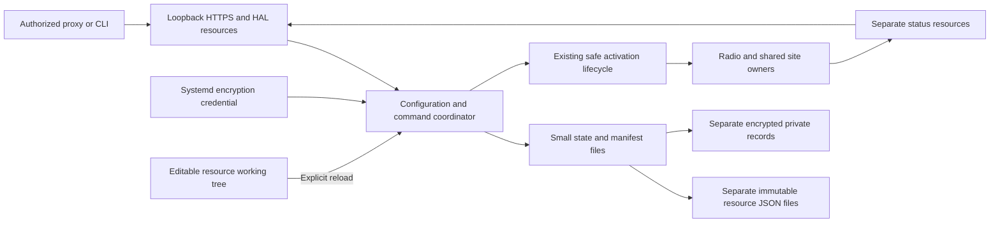

# Modular JSON Configuration and HAL REST API Design

Created: 2026-11-18  
Updated: 2026-11-19  
Status: Draft for review; unified events, controller-start permanent links and same-time execution ordering incorporated  
Logical parameter reference: [repeater-management.schema.json](../../../repeater-management.schema.json)  
Complete logical parameter example: [repeater-configuration-complete.example.json](../../../repeater-configuration-complete.example.json)

## Agreed direction

Configuration is a graph of independently stored and addressable resources. Neither the disk format nor a REST response is one expanded site-and-all-radios JSON document. The earlier single-envelope persistence layout, aggregate configuration endpoint and custom merge PATCH are superseded.

The user requires:

- JSON files on disk, divided into logical resources.
- A loopback HTTP REST API replacing the Unix-domain maintenance socket.
- HAL hypermedia linking resources, with GET on every endpoint.
- PUT and RFC 6902 PATCH on every writable endpoint, including writable collections.
- POST for radio configurations and independent optional AllStarLink, EchoLink and phone-patch configurations.
- Separate scheduled-event and command-macro resources with GET, PUT, PATCH, POST and DELETE on their collections.
- One command-macro type for scheduled and DTMF invocation, with ordered typed actions, permanent-link controls, nested named calls, DTMF execution and message playback.
- One string per configured message, reusing Fluent localization/runtime arguments and the existing checked media compositor.
- One scheduled-event model with required effective start and optional end, flat event resources, hron calendar expressions or controller_start, optional sequence_number, warning macros and minute-based boundary politeness. Preserve controller admission, generation and safety policy.
- DELETE on every endpoint that supports POST.
- Write-only protocol passwords, encrypted at rest using a separately supplied systemd service credential.
- Automatic validation, durable save and activation, with saved and active revisions reported separately.
- Explicit reload of hand-edited JSON; no automatic application by a file watcher.
- Management/recovery startup with affected transmitters inhibited after failed/interrupted activation.
- Loopback HTTPS with mandatory mTLS, separate authorized proxy/CLI identities, and CLI credential access controlled by a dedicated Unix administration group.

A radio port remains the existing single-radio controller concept. It has an exact local key, a friendly display name and an opaque UUID. A local key need not be an AllStarLink node number. Public identities, private service credentials and API-admission credentials remain distinct.

All these product decisions are recorded. Implementation details below are reviewable proposals. The linked checklist describes pending implementation work; this document does not itself execute product changes or deployment.

## Architecture



Reuse the Rust product, serialized control executor, radio provider, DSP, controller scheduler state machines, site backends, mailbox verifier and generation-based reload. Extend the separate schedule provider with hron recurrence evaluation as described below. Add resource-oriented models and serializers around those boundaries. No HTTP/TLS processing, file I/O, authentication, cryptography or device waiting belongs on audio callbacks.

The coordinator assembles effective settings in memory only when required for validation or runtime preparation. That assembly is not a persisted configuration file or an aggregate API representation.

The standalone host owns the listener. An Asterisk composition uses the same shared coordinator/serializers and receives the required credentials through its hosting unit. Preserve reload without restarting Asterisk. Use existing ABI extension points before changing released descriptors.

## Unknown JSON input and diagnostics

The 2026-11-19 implementation instruction preserves the warning-and-default policy for JSON. Log warnings and ignore unknown configuration keys and unknown, invalid or unsupported setting values. Resolve the affected setting through its remaining site/built-in inheritance chain; do not erase a valid inherited value or replace an entire valid object because one child is ignored. Apply the same rule to disk reload and API configuration writes. Normalized accepted objects and effective projections contain recognized usable settings only, so returned schemas describe canonical output rather than requiring rejection of every unknown input member.

Return structured, value-free diagnostics from core resolution and log them at the existing host/control owner. Use warnings for recoverable input or connection failures, and errors for fatal failures that take down a connection or the controller. Never log credentials or supplied values. Invalid JSON syntax, duplicate member ambiguity, malformed operation envelopes, failed preconditions and unsafe resource/reference/ownership relationships remain structural or lifecycle failures when no safe deterministic candidate can be constructed. This policy overrides earlier field-level wording that calls for rejection of an unknown or unsupported setting when a safe inherited/default fallback exists.

## Controller JSON and USBRadioPlus INI boundary

The controller accepts, stores, validates and reloads modular JSON only. Remove its custom INI parser, section/key resolver, INI-producing processing_configuration and old controller/private INI file paths. Native configuration queries return sanitized JSON resources, not the original INI text.

USBRadioPlus keeps its existing public INI format, loader and standalone/Asterisk/tuner consumers. Its current native interface already has typed fields but still reparses embedded INI for processing profiles and remote settings. The implementation plan uses existing typed fields plus a checked typed preparation extension for the remaining inputs, sharing provider resolved-setting builders with the unchanged INI frontend. This avoids keeping controller INI as a hidden intermediate configuration language.

Preserve profile presence/default semantics, remote options, memories/scans and owned native prepare/apply/finish lifetimes. Arbitrary canonical device/option strings cannot safely round-trip through the current provider INI parser, which has no quote/escape decoder and strips semicolon/hash suffixes and surrounding whitespace. Do not invent escaping or silently truncate; the typed boundary must preserve supported values and warn and ignore unsupported setting values through the normal inherited/default policy; reject only when no safe deterministic candidate remains. Provider compatibility/version checks and both JSON-controller/INI-provider regression suites are release prerequisites.

Remove controller INI-specific examples, installed paths, tests and documentation while retaining negative rejection tests and provider-owned INI tests. Controller-authored static_directory_file currently uses [extnodes] INI in both hosts; replace it with a JSON static-node table/resource and typed lookup, preserving static-first/source-authentication semantics. Downloaded external directory feeds are protocol data and retain a separately owned decoder/fallback path. Remove iax-secrets.conf and its implicit/default/check/reload paths in favor of the encrypted credential owner. The [implementation checklist](../plans/2026-11-19-json-rest-implementation-checklist.md) tracks the complete work; completion is recorded there as each step is verified.

## Protocol jitter and phone-patch keying

Phone patch has no tx or keying_mode switch. Receive admission uses the shared VAD settings and runtime receiver mute. The removed local/remote lists, exposed attachment/reverse-call limits and check_deadline_ms remain absent; owning-port/admission context and runtime bounds still apply.

Phone vad references shared $defs.vad: enabled, mode and timing.hang_ms retain their bounds. Phone defaults remain enabled=true, mode=continuous, hang_ms=1000; global radio enabled=false is unchanged. Apply context defaults before sparse overrides. Disabling VAD removes its speech qualification and uses other enabled keying signals. A live usable phone caller with VAD disabled receives continuously while unmuted. A healthy SSB USB/LSB receiver without another qualifier also receives continuously when VAD is disabled. Explicit COS/CTCSS/DCS or other enabled qualifiers, source availability and safety gates still apply. Kerchunk without a usable independent closing qualifier retains the shared continuous-VAD fallback/warning.

Use one $defs.jitter object in phonePatch, echolink and allstarlink, and their public response profiles. jitter.timing contains minimum_ms, initial_ms and maximum_ms (nonnegative integers, current defaults20/40/100). After inheritance validate minimum<=initial<=maximum plus each transport's capability and latency requirements. This is one shared configuration shape; adapters may have different native playout implementations and must apply supported explicit values rather than ignore them.

Keep phone timing.target_latency_ms and timing.maximum_latency_ms as end-to-end phone playout budgets; they are distinct from the adaptive jitter maximum. Remove jitter_* prefixes after moving those fields into jitter.timing. Apply normal site/port inheritance and sparse PATCH semantics to all three protocol jitter objects. Shared jitter defaults/settings do not implicitly attach optional protocol accounts.

The existing command settings object contains the DTMF terminator/mappings and inactivity_timeout_ms. Phone-patch DTMF uses that invoking port's effective command.inactivity_timeout_ms (default3000); do not add a phone timeout copy or resurrect check_deadline_ms. A value change activates with the same prepared generation as other DTMF settings and cannot create competing call-local completion timers.

Editable [phone-patch example](../../../examples/phone-patch.example.json), shown as a public settings body with credentials omitted:

```json
{
  "provider": {
    "protocol": "sip",
    "server": "sip.example.net",
    "port": 5060,
    "username": "example-user"
  },
  "vad": {
    "enabled": true,
    "mode": "continuous",
    "timing": {
      "hang_ms": 1000
    }
  },
  "jitter": {
    "timing": {
      "minimum_ms": 20,
      "initial_ms": 40,
      "maximum_ms": 100
    }
  },
  "playout_destination": "local",
  "isolate_peers": true,
  "timing": {
    "target_latency_ms": 240,
    "maximum_latency_ms": 500
  }
}
```

Implementation updates protocol DTOs, shared jitter preparation/adapter bindings and phone keying preparation together. Canonical/API writes warn and ignore removed fields. Offline administrator-led conversion maps hang/jitter settings to shared objects and reports removed tx/keying_mode controls; the controller has no deployed legacy importer. Old manual mode is not equivalent to continuous VAD-disabled reception; report that behavior change rather than silently preserving a manual latch. Provider credential writes remain private and all GET projections continue to omit passwords.

## Receiver mute and keying

Add rx_mute_toggle to the shared action vocabulary, reusable by runtime requests, macros and DTMF mappings. Its default mapping is phone-patch-only; it never implicitly toggles the local RF receiver or network peers:

```json
{
  "command": "*99",
  "protected": false,
  "action": "rx_mute_toggle",
  "target": "phone_patch"
}
```

The owning port comes from the invocation context. target selects port, peer, peers or phone_patch. For peer, parameter identifies one current direct network peer. For peers, optional link_type filters allstarlink or echolink; omit it for all current network peers. These peers exclude phone callers, which retain private call identities. Routing mode/permanence and EchoLink proxy transport are not link types. No other default DTMF code is invented; operators can bind the same action with another target or call it from a macro.

Editable [RX mute examples](../../../examples/rx-mute.example.json) show all target forms. A filtered action is:

```json
{
  "action": "rx_mute_toggle",
  "target": "peers",
  "link_type": "echolink"
}
```

### Target resolution and toggle state

Use one runtime mute bit per ingress. The implementation proposals are: a port bit lives for that port/controller run; each peer/caller bit lives for its exact connection generation. New streams start unmuted, reconnects do not inherit old stream bits, unchanged live identities preserve state through reload, and process restart clears bits. These are runtime observations, not saved configuration toggles.

For a group, snapshot connected matching peers at execution. If every selected ingress is muted, unmute all; otherwise mute all, including a mixed selection. An empty set is a no-op. Group and individual operations update those same ingress bits, with no extra group latch or future-peer policy. Never dial/attach a peer or set retained permanent retry intent as a side effect.

Resolve a single peer to its exact live protocol/connection identity; reject missing/ended/ambiguous identities. For phone_patch invoked by a caller, select that exact actual PhoneSource/call/reply context. For an authorized nonphone invocation, parameter is the exact opaque call_id returned by that port's phone-patch status (not a node/mailbox number), or omission selects the unique attached caller; reject absent/ambiguous selection instead of choosing another caller or all calls. Existing caller/port authorization remains authoritative.

Keep toggles admission-once under request/generation identity. Compute the selected desired states once; queue retries apply that state, not a second inversion. Stale connection tokens cannot toggle a replacement session. Read-only status reports radio.rx.muted/active, each link rx.muted/active plus link_type, and each phone call rx.muted/active.

### Audio and receive-keying gate

For each source independently:

```text
effective_receive = normal_qualified_receive AND NOT rx_muted
admitted_audio = source_audio when effective_receive, otherwise silence
receive_key_demand = OR of the effective receiving sources
```

normal_qualified_receive retains all configured source availability, audio enables, VAD/COS/CTCSS/DCS and other qualifier policy. Mute is an additional AND gate; it never forces any qualifier true. VAD disabled removes only its own condition. If no other qualifier applies, phone and SSB reception is continuous while live/healthy and unmuted. Muting one source removes only its own audio/keying contribution; other sources, telemetry and independent TX/safety ownership remain intact.

Gate PCM and activity before source mixing, RF repeat, parrot capture and peer fanout. Blanking samples alone is insufficient because peer activity can also come from radio_keyed. Continue bounded consumption and discard muted source data/queued source-owned playout so unmute cannot replay buffered muted speech. Publish through the existing control-to-audio ownership boundary; do not free or allocate media on callbacks.

Keep raw observations, VAD/qualifier detection, transport liveness and DTMF control active. A user mute is not an actual receiver unkey and must not complete/clear a command candidate. This is essential so a muted phone caller can enter *99 again. OOB peer digits and EchoLink inband detection remain usable. Suppress regenerated received DTMF audio/keying from muted ingress while retaining command interpretation and legitimate generated replies; preserve source provenance before DigitOutcome::Regenerate loses it.

Source integration points are the [local detector/programme gate](https://github.com/cpeter1207/rpt_advanced/blob/8188d5f0e6a738ac38e04e6fea2ba64c150e5ce9/rust/product/src/worker.rs#L685), [peer audio/activity mix](https://github.com/cpeter1207/rpt_advanced/blob/8188d5f0e6a738ac38e04e6fea2ba64c150e5ce9/rust/core/src/link/audio.rs#L558), and [private phone identity](https://github.com/cpeter1207/rpt_advanced/blob/8188d5f0e6a738ac38e04e6fea2ba64c150e5ce9/rust/core/src/link/phone.rs#L95). Phone media/keying integration remains design work; the current private-call foundation is command-only. The new action is a proposed implementation requirement, not a claim that those source handlers already implement it.

Validate all targets/filter combinations, default phone-only dispatch, exact caller resolution, mixed/all-muted/empty groups, no effect on nonmatching peers, stale/reconnected identities, request retry without double toggle, source PCM plus keyed=true, queued speech discard, muted-source DTMF and unmute, regeneration provenance, VAD-off phone/SSB continuity, remaining qualifiers, live status and independent TX safety.

## Resource boundaries and ownership

### Ordinary configuration sections

Store one logical section per resource, rather than one file per parameter or one complete radio tree. Typical sections are:

| Scope | Resource examples |
| --- | --- |
| Site | Metadata, radio defaults, RX audio defaults, RX signaling defaults, TX audio/signaling defaults, interface defaults, peer-audio defaults, protocol defaults |
| Radio port | Metadata, general radio settings, RX audio, RX signaling/timing, TX audio/signaling, interface, radio control, limits/power, memories, scan lists |
| Named definitions | Sensors, inputs, outputs, alarms, fans, mailboxes, telemetry definitions, named messages and legacy permanent groups |
| Scheduler | One resource per event in one collection; start is required, end optional, and each boundary references a command macro |
| Commands | Command settings and one collection of command macros shared by scheduled, named and DTMF callers |
| Optional protocols | One independent AllStarLink, EchoLink or phone-patch instance per port/protocol kind |
| Private data | One encrypted account/scope record, separately referenced from public resources |

A port metadata resource owns scope identity/display fields such as `name` and `inherit_from` plus the port-common overrides `enabled`, `callsign` and `language`. Those common overrides remain inheritable settings. Its PUT never replaces linked audio, interface, scheduler or protocol resources.

Ordinary section resources exist logically for an existing scope even when their local overrides are empty. An absent working file for such a section means an empty override, not deletion of the port. PUT/PATCH can establish overrides without POST because the section resource already exists logically.

### Inheritance and optional instances

Keep sparse authoring overrides. Resolve built-in defaults, then site defaults, then port overrides. Do not persist expanded defaults into child files. Only identity/display metadata such as ID, local key, `name` and `inherit_from` is scope-local; `enabled`, `callsign` and `language` still inherit.

Named-definition maps merge by logical key, and matching public definition bodies merge field by field: objects merge recursively, arrays/scalars replace, and omitted fields continue to follow site changes. A local definition can therefore contain only overrides if its effective result is valid. A local deletion may reveal the inherited definition again. Mailboxes are the explicit exception: a local mailbox shadows the complete site identity and requires its own complete valid profile/hash. Effective resources identify source scopes through HAL links.

Protocol attachment is explicit and does not inherit. Site protocol defaults supply settings only to an explicitly created port protocol instance. An empty port protocol inventory means no account, registration, provider session or account credential requirement for that protocol. A port can have none of AllStarLink, EchoLink and phone patch.

EchoLink becomes an independent sibling of AllStarLink in storage, API models, examples and migration. Its proxy settings remain an EchoLink child. Protocol-neutral peer DSP belongs in a separate `peer-audio` resource so EchoLink-only operation does not require an AllStarLink configuration. Move the formerly shared link-processing settings there; retain genuinely protocol-specific fields under their protocol. Its configuration is the linkProcessing object directly (enabled, gains, ordered stages and their timing/settings), without a redundant processing wrapper or a named INI link_profile selector. Resolve that one inherited per-port peer-audio resource to the existing Link processing role independently of which protocols are present.

Keep one instance per port/protocol kind in this contract, matching the current single-account model. POST to an occupied kind returns a conflict. A future multi-account model would require explicit routing/cardinality changes.

Shared site equipment retains one logical/physical owner. Inheriting settings exposes references to that owner rather than duplicating acquisition, alarms, fan control or outputs. A changed physical source must pass exclusive-ownership validation. Preserve the existing scheduler's scope/execution policy when moving its definitions into individual resources.

### Candidate identity and ownership

The in-memory candidate assembly takes already captured resource bytes and an
authoritative registry of UUIDs, exact port keys, kinds and owners. Cross-check
the documented file identities against that registry. Do not derive ownership
from payload fields or local-key text. Missing ordinary records retain their
known registry identity and mean an empty local override; missing optional port
protocol records mean no configured instance. Site defaults cannot create one.

Every ordinary section may have site defaults, including control, memories and
scan lists; the abbreviated layout below is not a scope restriction. The
ordinary working-file envelope uses id, kind and configuration; port metadata
also retains key. Owner/scope are capture/manifest context, not additional
authoring fields. Unknown extra fields follow the warning/ignore policy. Flat
events retain their separately specified root-level form.

Raw candidate section bodies remain unvalidated staging data. Only normalized
typed metadata is an effective settings view at this stage. Do not automatically
serialize these raw bodies into public HAL or activate them. Filesystem capture,
profile/capability validation and durable state publication remain separate
control-plane responsibilities.

## Modular JSON storage

### Layout

Use a service-owned directory such as `/var/lib/rpt-advanced` with mode `0700` and protected files with mode `0600`:

```text
state.json
manifests/<manifest-id>.json
objects/<resource-uuid>/<version>.json
private/<credential-uuid>/<version>.sealed.json
journals/<transaction-id>.json
working/
  site/
    metadata.json
    radio.json
    rx/audio.json
    rx/signaling.json
    tx/audio.json
    tx/signaling.json
    interface.json
    peer-audio.json
    control.json
    memories.json
    scan-lists.json
    protocol-defaults/allstarlink.json
    protocol-defaults/echolink.json
    protocol-defaults/phone-patch.json
    schedule/events/<event-uuid>.json
    command/macros/<macro-uuid>.json
    telemetry/messages/<message-uuid>.json
    sensors/<sensor-uuid>.json
    outputs/<output-uuid>.json
    ...
  ports/<port-uuid>/
    metadata.json
    radio.json
    rx/audio.json
    rx/signaling.json
    tx/audio.json
    tx/signaling.json
    interface.json
    peer-audio.json
    control.json
    memories.json
    scan-lists.json
    protocols/allstarlink.json
    protocols/echolink.json
    protocols/echolink-proxy.json
    protocols/phone-patch.json
    schedule/events/<event-uuid>.json
    command/macros/<macro-uuid>.json
    telemetry/messages/<message-uuid>.json
    ...
```

Protocol files exist only when their instances are configured; they are not required placeholders. Other ordinary override files may also be absent when empty. Named objects each have their own file. The ellipses cover the other logical sections listed above.

Accepted resource objects and manifests are immutable. The supported hand-edit surface is `working/`. Never hard-link mutable working files to immutable objects. Raw local keys, names and JSON Pointer tokens never become filenames; use UUID paths and retain exact names in JSON/registry metadata.

A resource file contains its writable configuration and necessary identity metadata, not HAL links, effective inherited state or live observations. For example:

```json
{
  "id": "33333333-3333-4333-8333-333333333333",
  "kind": "rx-audio",
  "configuration": {
    "enabled": true,
    "deemphasis": {
      "enabled": true,
      "corner_hz": 300
    }
  }
}
```

### Manifests and the commit point

A manifest contains IDs, versions, hashes, ownership and references to public/private objects, plus the exact local-key-to-port-ID registry. It does not embed configuration bodies.

The initial public-manifest staging codec fixes the previously illustrative
field names: format_version=1, id, revision, site_uuid, port_keys and resources.
port_keys maps exact JSON-string local keys to UUIDs. A resource row has kind
and owner; its version/object/sha256 reference triplet is either fully present
or fully absent. SHA-256 uses 64 lowercase hexadecimal digits over exact object
bytes, and object must be the path derived from the row UUID and version.
Metadata requires an object; an empty ordinary/site-default row retains its
identity. A port protocol row requires an object, and absent protocols have no
row. The supported staging codec does not require the complete future resource
catalog. Its optional private reference selects the authenticated account index described below.
Unknown extra members warn and are ignored; unsafe identities, integrity fields,
unsupported kinds and format versions cannot safely default.

Manifest IDs, logical revisions and object versions have distinct types. Tokens
are nonempty single POSIX components excluding dot, parent-dot, slash and NUL;
UUID paths are canonical, and local keys never become path components. Verified
readback takes a trusted manifest ID, revision and exact-byte digest from its
selecting owner. It does not discover/select state.json, choose accepted state
or validate opaque domain bodies. Those coordinated responsibilities remain
later work. The example below shows only the currently modeled public kinds;
object bodies are separate files.

```json
{
  "format_version": 1,
  "id": "manifest-42",
  "revision": "r-42",
  "site_uuid": "11111111-1111-4111-8111-111111111111",
  "port_keys": {},
  "resources": {
    "11111111-1111-4111-8111-111111111111": {
      "kind": "metadata",
      "owner": "11111111-1111-4111-8111-111111111111",
      "version": "v-3",
      "object": "objects/11111111-1111-4111-8111-111111111111/v-3.json",
      "sha256": "63781307a48e20674a88b12a8d81821db30dcff3fa867bf0ebeea67ae87b75f5"
    },
    "33333333-3333-4333-8333-333333333333": {
      "kind": "rx-audio",
      "owner": "11111111-1111-4111-8111-111111111111",
      "version": "v-7",
      "object": "objects/33333333-3333-4333-8333-333333333333/v-7.json",
      "sha256": "3952b26dbd72bef6606a9ab1409ee3280cbf147c2aa681af414df137288d4093"
    }
  }
}
```

The format-1 state pointer requires all of the following members. Digests use
64 lowercase hexadecimal digits over the exact stored bytes. The desired and
last-known-good selectors each contain `manifest`, `revision` and `sha256`.
Initial provisioning permits a null last-known-good selector.

```json
{
  "format_version": 1,
  "store_uuid": "31c6bf12-7e60-4b4b-86be-71a3c065dc95",
  "desired": {
    "revision": "r-42",
    "manifest": "manifest-42",
    "sha256": "63781307a48e20674a88b12a8d81821db30dcff3fa867bf0ebeea67ae87b75f5"
  },
  "last_known_good": null,
  "activation": {"target_revision": "r-42", "state": "pending"},
  "publication_journal": {
    "id": "11231232-0055-4675-a3c2-4e843b5192ef",
    "sha256": "3952b26dbd72bef6606a9ab1409ee3280cbf147c2aa681af414df137288d4093"
  },
  "clean_working_sha256": null
}
```

Activation states are `pending`, `confirmed`, `failed` and `recovery_required`.
The target revision equals desired. Confirmation requires equal desired and
last-known-good references. A selected journal requires pending activation
and a null clean fingerprint. Clean publication removes the journal reference
and sets the complete working fingerprint. Runtime adoption is a separate
observation supplied by the active process.

A journal at `journals/<uuid>.json` requires `format_version`, `id`,
`store_uuid`, `prior_state_sha256`, `desired`, `source_working_sha256`,
`target_working_sha256`, ordered `changes`, and `prune_directories`. Each row has a unique
catalog-relative `path`, nullable `source_sha256`, and nullable `target`.
A target selects `resource_uuid`, `version` and `sha256` from the desired
manifest. Null represents absence, including an absent source distinct from
a present zero-length file. Only explicit empty-store provisioning admits a
null prior selector digest. The prior digest is compared at the pointer switch.
The journal records empty directories of retiring ports in child-before-parent
order. Reconciliation removes recorded files and directories before installing
replacements. A new file in a retiring directory blocks pruning. Planning counts
the peak source and target layouts after those explicit retirements.

Explicit provisioning takes the expected store UUID. In an empty protected
root it first creates and syncs an empty `.bootstrap-<store-uuid>` directory.
With the same UUID, an interrupted layout or pre-pointer initialization can
resume under the fixed lock. The first durable selector consumes the marker
and syncs the root before success. An established store which loses its selector
has no bootstrap authority.

Before recovery publishes any working bytes or confirms an already-clean
selector, it verifies the exact selector, synchronizes it and the store root,
then rechecks the binding. A clean switch synchronizes every captured regular
file and all surviving working directories bottom-up, including the working
root, so editor additions, replacements and removals enter the durable baseline.
A save checks every reachable bookkeeping pointer against the encoded size
limit and proves omitted immutable objects durable before selecting them.
An explicit restore may supersede a selected journal with an exact observed
pointer and working fingerprint. Its prepared graph must match the selected
desired or last-known-good manifest being restored. It uses a fresh revision,
immutable journal and pointer switch before issuing any recovery writes.

Replacing and syncing `state.json` is the sole atomic cross-resource commit point. A transaction can modify several resource files and encrypted credential records together without writing a monolithic JSON snapshot. Unchanged immutable objects are shared by reference.

Logical revisions change for configuration/credential changes and deliberate restoration. Runtime generations and immutable object versions are distinct. Last-known-good advances only after confirmed activation. Re-encryption/activation bookkeeping preserves logical revisions.

Garbage collection removes only objects unreachable from desired, last-known-good, retained recovery history and pending journals. Backups retain manifests plus referenced objects, not one expanded JSON export, and retain corresponding keys separately.

### Private records and systemd keys

Keep protocol passwords, account bindings, inheritance masks and mailbox/admin hashes in separate encrypted records. Hashes remain hashed inside encryption. Public files never contain private records or configured flags.

Use a maintained authenticated-encryption implementation. The sealed primitive uses XChaCha20-Poly1305 with a separately supplied random 32-byte key and a fresh random 24-byte nonce for every encryption. [Construction documentation](https://doc.libsodium.org/secret-key_cryptography/aead/chacha20-poly1305/xchacha20-poly1305_construction)

Bind associated data to storage/sealed-format versions, a fixed private-record purpose, immutable store UUID, credential-record UUID and immutable sealed-object version. Account, scope and protocol-instance bindings are inside the encrypted payload. Do not bind ciphertext to the global configuration revision or desired/last-known-good slot. This allows unrelated configuration changes and manifest promotion to reuse unchanged encrypted objects. Any actual encryption gets a new version/nonce.

The initial sealed envelope emits only format_version=1, key_id, nonce and
ciphertext. Nonce and ciphertext use canonical standard base64 without padding;
ciphertext includes the 16-byte authentication tag. Trusted store/credential/
immutable-version UUIDs are supplied externally to decoding. Sealing generates
the immutable version as a fresh UUID v4 independently of the nonce; callers
cannot choose a reused sealing version.

The exact AAD frame starts with ASCII rpt-advanced.private-record followed by
one NUL byte, then big-endian u32 storage-format 1 and sealed-format 1, then the
three raw 16-byte store/credential/version UUIDs, then a u8 key-ID byte length
and its ASCII bytes. This additionally authenticates key routing metadata.
Unknown extra envelope members warn/ignore; invalid required integrity fields
or failed authentication cannot safely default. The primitive treats plaintext
as opaque zeroizing bytes. A later private-payload owner must validate account,
scope, protocol and record type before use; authenticated bytes alone do not
establish those application bindings. The crypto primitive alone does not
adopt private graph references or publish files.

A typed prepared-private-record bridge now connects sealing to protected
immutable storage. Preparation seals and encodes once. Its private fields cannot
be populated from raw bytes or a decoded envelope. Installation derives only
private/<record-UUID>/<version-UUID>.sealed.json and reuses the shared exclusive
staging, file sync, no-replace publication and directory sync. Protected parent
directories must already exist. Exact-byte retries use the same prepared
identity/nonce/version, including after an uncertain synchronization outcome.

Private readback takes trusted identity and ciphertext hash, verifies protected
bounded bytes, decodes the envelope, loads the selected delivered key and
authenticates before returning zeroizing plaintext and value-free warnings.
The file-size cap is intersected with the sealed-document cap before reading;
hash/shape failures precede key lookup. Missing keys/authentication failures do
not repair, regenerate or rewrite files. The trusted selecting owner associates
the root with the context's store UUID; that identity is never inferred from
ciphertext. Raw public object/manifest target constructors cannot select private
paths. The account-bound index and transaction owner validate private adoption as described below.

### Account-bound encrypted graph

A public format-1 manifest may contain `private: {record, version, sha256}`. Record and version are canonical UUIDs; the digest covers the exact sealed envelope at the derived `private/<record>/<version>.sealed.json` path. The reference contains no account value, configured flag or credential hash. Omission selects no private graph.

The encrypted index plaintext is JSON: `{format_version: 1, records: [[owner, reference], ...]}`. An owner is `[scope_role, scope_uuid, resource_uuid, slot_tag, parent_uuid_or_null]`; only an EchoLink proxy child has a parent UUID. Rows are canonical, nonempty and unique. The index contains references only. Each sealed leaf plaintext is `{format_version: 1, owner, account, value}`. A nonempty string is bound to the final effective account; a mask has null account and value. A retained mailbox cannot mask its PIN and become permissive.

| Private slot | Exact account affinity |
| --- | --- |
| `allstarlink-password` | Network node number and effective registration URL |
| `echolink-password` | Canonical callsign, network node number and ordered canonical directory hosts |
| `proxy-password` | Parent callsign/node number and canonical proxy host/TCP port |
| `phone-password` | SIP or IAX2, canonical server, port and exact username |
| `admin-unlock`, `admin-lock` | Site/port command-resource UUID; no additional account value |
| `mailbox-pin` | Registered mailbox number, with a complete local first-name/callsign identity |

Scope, instance, slot and proxy-parent bindings are checked against the full public registry. Duplicate record IDs, self-reference, missing owners and invalid bindings fail closed. Every leaf must authenticate under the selected index key ID. Index and leaf envelope bytes and paths share the public transaction's aggregate limits. Restore compares the private reference as well as public membership and objects.

Omission reuses the same-scope encrypted record; explicit empty/removal masks inheritance. A changed account without replacement becomes an unusable mask, so returning to the old account cannot resurrect the password. Deletion retires desired reachability; recreating the same logical key has a fresh resource UUID. A local mailbox shadows the complete site identity and its private PIN. Mailbox hashes use the existing bounded Argon2id policy; administration hashes retain their existing, separately validated Argon2id contract.

The private codec keeps JSON tokens and decoded strings in zeroizing storage. Its pinned JSON slice reader uses caller-owned zeroizing scratch for escapes. Before creating any immutable public shard, validate the whole supplied batch's sizes, hashes, declared IDs/kinds and reserved secret namespaces. Readback applies the same public-envelope guard. Authoring normalization handles invalid private settings with value-free warnings; unsanitized private containers cannot enter public storage.

Every production host supplies an explicit, externally selected write-key ID when constructing the transaction owner, even for an empty/public-only store. Missing, unauthentic or incompatible keys preserve public management reads, omit unknown configured flags, and block writes, replay and activation. Normal saves do not rotate keys. Keyless low-level public fixtures are not the production host policy. Stop-writer rotation, retained-key backup and reachability garbage collection remain separate maintenance work.

The accepted public manifest selects the encrypted graph through the same journal/state-pointer commit. This storage checkpoint does not itself activate a runtime owner or expose an HTTP credential endpoint.

Per D6, read keys only from `$CREDENTIALS_DIRECTORY/rpt-advanced.aead.<key_id>`. IDs match `[A-Za-z0-9_-]{1,64}`; each credential contains exactly 32 raw bytes. Use this on the hosting unit:

```ini
[Service]
ImportCredential=rpt-advanced.aead.*
```

The separately provisioned credential may come from `/etc/credstore/rpt-advanced.aead.service-key-1`, root-owned `0600`. The application reads its systemd-delivered copy. Missing imports must allow locked management startup; do not make an absent absolute source prevent ExecStart. Apply the directive to the standalone unit or `asterisk.service` as appropriate. [Systemd 257 credential settings](https://www.freedesktop.org/software/systemd/man/257/systemd.exec.html#ImportCredential=GLOB)

Never place key bytes in JSON, unit literals, environment variables, arguments, HTTP or logs. Keep decrypted buffers non-printable and off audio callbacks. There is no automatic replacement-key or empty-store fallback for a store that cannot authenticate.

The loader reads only the env-provided credential directory and fixed validated
basename, with no caller filesystem path or legacy key/password fallback. It
opens no-follow descriptors, verifies regular file/bindings, and consumes exactly
32 raw bytes plus a bounded one-byte EOF probe. It never trims a newline,
changes permissions or prints a key digest. Systemd 257 may deliver root-owned
0440 files/0550 directories through a named service-user ACL, or service-owned
0400/0500 without ACLs; the legacy 0600/effective-UID password rule is unsuitable.
Kernel access checks enforce delivered ACLs. Opaque wrappers remain necessary:
zeroizing buffer types are not automatically safe to print.

A missing/wrong key, unsupported sealed format or authentication failure preserves the store, inhibits affected TX and blocks configuration mutation/import/apply/restore with a sanitized unavailable result. Public fields may remain readable; omit unknown configured flags and report `secrets_state: "locked"` or `"error"` rather than fabricating false.

Key rotation is local maintenance. Stop the writer, provide old/new systemd credentials, authenticate retained private objects, write newly sealed objects/manifests, and atomically switch retained state references without changing logical revisions. Retain old keys for recovery/backups. Service credentials are [immutable while the unit runs](https://systemd.io/CREDENTIALS/); refreshing delivered keys requires an owner-unit restart. Ordinary JSON reload remains in-process.

## HAL representations and discovery

Return domain resources as `application/hal+json`. Use the published HAL draft as this API's profile; HAL is an Internet-Draft, not an RFC. [HAL draft 11](https://www.ietf.org/archive/id/draft-kelly-json-hal-11.html)

Root resources are navigation indexes. They link to site metadata, port collections, configuration sections, statuses, changes and operations; they never embed every configuration tree. `_embedded` contains only bounded summaries unless a specific profile states otherwise.

Give each response `self` and appropriate `up`, `profile`, child, effective, status and change links. Define extension relations through a stable `rpt` CURIE. Use origin-relative URLs under a configured prefix, not untrusted forwarded Host data. Keep relation cardinality stable; an item relation stays an array even for one item.

Include the CURIE declaration in each document using `rpt:` relations; do not assume declarations from a previous HTTP response are inherited.

HAL does not define write forms or HTTP methods. Publish request schemas, `Allow`, `Accept-Patch` and code-derived OpenAPI. Generate OpenAPI 3.1 from the Rust route/schema inventory and serve an offline interactive Swagger UI at `/api/v1/docs`; both documentation routes require the same backend mTLS authorization as every other endpoint. Schema/docs endpoints support GET using their appropriate schema/document media types and are discoverable from HAL links.

Example API entry point:

```json
{
  "_links": {
    "self": {
      "href": "/api/v1/"
    },
    "curies": [
      {
        "name": "rpt",
        "href": "/api/v1/rels/{rel}",
        "templated": true
      }
    ],
    "rpt:site": {
      "href": "/api/v1/configuration/site/"
    },
    "rpt:ports": {
      "href": "/api/v1/configuration/ports/"
    },
    "rpt:status": {
      "href": "/api/v1/status/"
    },
    "rpt:operations": {
      "href": "/api/v1/operations/"
    },
    "describedby": {
      "href": "/api/v1/openapi.json"
    }
  }
}
```

Example writable audio resource:

```json
{
  "_links": {
    "self": {
      "href": "/api/v1/configuration/ports/11111111-1111-4111-8111-111111111111/rx/audio/"
    },
    "curies": [
      {
        "name": "rpt",
        "href": "/api/v1/rels/{rel}",
        "templated": true
      }
    ],
    "up": {
      "href": "/api/v1/configuration/ports/11111111-1111-4111-8111-111111111111/"
    },
    "profile": {
      "href": "/api/v1/profiles/rx-audio/"
    },
    "rpt:effective": {
      "href": "/api/v1/effective/ports/11111111-1111-4111-8111-111111111111/rx/audio/"
    }
  },
  "meta": {
    "configuration_revision": "r-42",
    "resource_version": "v-7"
  },
  "configuration": {
    "enabled": true,
    "deemphasis": {
      "enabled": true,
      "corner_hz": 300
    }
  }
}
```

HAL navigation and `meta` are server-owned. The audio profile shown here targets `configuration`; event profiles expose `start` and optional `end` directly at the root alongside the creation key. Clients submit the published writable projection, omitting server-owned links/status. Resource PUT/POST use the documented HAL writable profile, with `application/hal+json`; omitted reserved HAL properties remain valid HAL. PATCH uses its own standard media type.

## Endpoint and method matrix

The prefix is `/api/v1`. `scope` denotes site or an existing UUID-addressed port. Protocol-kind collections are separate for `allstarlink`, `echolink` and `phone-patch`.

| Endpoint/profile | Methods | Owned state |
| --- | --- | --- |
| API/configuration/effective/status navigation roots | GET | Links and summaries only |
| `/configuration/site/` | GET, PUT, PATCH | Site metadata |
| `/configuration/ports/` | GET, PUT, PATCH, POST, DELETE | Port reference inventory; POST creates a port |
| `/configuration/ports/{port}/` | GET, PUT, PATCH, DELETE | One port's metadata |
| `{scope}/{section}/` | GET, PUT, PATCH | One ordinary settings section |
| `{port}/protocols/` | GET | Links to the three optional-kind collections |
| `{port}/protocols/allstarlink/` | GET, PUT, PATCH, POST, DELETE | Zero/one AllStarLink instance |
| `{port}/protocols/echolink/` | GET, PUT, PATCH, POST, DELETE | Zero/one independent EchoLink instance |
| `{port}/protocols/phone-patch/` | GET, PUT, PATCH, POST, DELETE | Zero/one phone-patch instance |
| `{port}/protocols/{kind}/{account}/` | GET, PUT, PATCH, DELETE | One existing protocol instance |
| EchoLink proxy and existing-owner credential views | GET, PUT, PATCH | Proxy settings or private-store write instructions |
| `{scope}/schedule/events/` | GET, PUT, PATCH, POST, DELETE | Local event inventory |
| `{scope}/schedule/events/{event}/` | GET, PUT, PATCH, DELETE | One scheduled event |
| `{scope}/command/macros/` | GET, PUT, PATCH, POST, DELETE | Local unified command-macro inventory |
| `{scope}/command/macros/{macro}/` | GET, PUT, PATCH, DELETE | One command macro used by scheduled, named or DTMF callers |
| Other named-definition collections | GET, PUT, PATCH, POST, DELETE | Local sensors/messages/etc. inventories |
| Other named-definition members | GET, PUT, PATCH, DELETE | One definition |
| Matching effective/status resources | GET | Resolved values/observations, never writable |
| `/operations/{boot_id}/{request_id}/` | GET, PUT, PATCH | Draft/submitted command and receipt |
| Operation index, changes, health, relation/profile/schema/docs endpoints | GET | Read-only discovery/results |

Thus every endpoint supports GET, every writable endpoint has PUT and PATCH, and every POST endpoint also has DELETE. A valid GET can return a missing-resource/error result; it does not fabricate an optional instance.

READ-only views remain GET-only. HEAD/OPTIONS can expose metadata. Unsupported methods return 405 and an accurate Allow header. Every route is subject to the selected mTLS admission policy.

### Writable collection semantics

A collection's authoring state is a reference inventory, not embedded copies of all members:

```json
{
  "_links": {
    "self": {
      "href": "/api/v1/configuration/ports/"
    },
    "profile": {
      "href": "/api/v1/profiles/port-collection/"
    },
    "item": [
      {
        "href": "/api/v1/configuration/ports/11111111-1111-4111-8111-111111111111/"
      }
    ]
  },
  "meta": {
    "configuration_revision": "r-42"
  },
  "configuration": {
    "members": [
      "11111111-1111-4111-8111-111111111111"
    ]
  }
}
```

- GET returns the complete local reference inventory. Embedded member summaries may be paginated, but `configuration.members` is never one partial page. Bound inventories through documented resource-count/request limits. A paginated summary view links to the canonical collection GET used for edit preconditions.
- PUT replaces the inventory using currently existing, correctly owned IDs. Omitting members invokes their normal removal/retirement lifecycle.
- PATCH can reorder/remove existing references using standard array operations; it cannot invent a new member ID, duplicate membership or transfer ownership.
- POST creates a member, assigns its UUID and adds it. Creation cannot be smuggled through collection PUT/PATCH.
- DELETE clears the collection's owned local members. The collection endpoint remains and GET returns an empty inventory. This is not deletion of the category itself.

Collection removal is validated and committed atomically. Dangling references/ownership conflicts produce a conflict before any deletion, and affected radios/accounts/occurrences retire safely after commit. Clearing all ports leaves management running. Clearing local named overrides may reveal inherited definitions; clearing optional protocol instances does not reattach site defaults.

Deleting a member applies the same rules to that member and owned subresources. Password records are removed from desired state; historical private blobs remain only through retained recovery references. Recreating a key/kind allocates a fresh identity and never recovers removed credentials implicitly.

## Radio, protocol, event and macro creation

POST radio metadata to the ports collection. It does not require posting all audio/interface/processing settings. Its response links to those existing logical sections for later PUT/PATCH. A staged setup can explicitly set `enabled: false`.

An optional protocol is created at its own kind collection. For example:

```http
POST /api/v1/configuration/ports/11111111-1111-4111-8111-111111111111/protocols/echolink/
Content-Type: application/hal+json
If-Match: "<collection-etag>"
```

```json
{
  "configuration": {
    "enabled": false,
    "callsign": "N0CALL-L",
    "node_number": 100001,
    "credentials": {
      "password": "EXAMPLE-PASSWORD"
    }
  }
}
```

Credentials in creation input are an atomic write-only companion to the account settings. GET never returns that password. An instance links to its own settings, credential, effective and status resources. EchoLink creation does not create or require an AllStarLink resource; phone patch is equally independent.

Scheduled events and command macros are separate named resources. There is one macro type and one `command.macros` namespace per effective scope. Events call a command macro by its logical key; they invoke it directly without injecting DTMF. A DTMF mapping can use call_macro to invoke the same definition that a schedule or named caller uses; macro definitions have no separate trigger. Events expose HAL links to each resolved start/end/warning macro. Events have one shape, with start required after inheritance and end optional; a start-only event uses the same executor and politeness logic. There is no separate point/one-shot event type or windows collection.

Create a macro at `{scope}/command/macros/`. This definition can be called by an event or call_macro; expose it to DTMF through a mapping:

```json
{
  "key": "connect_net",
  "configuration": {
    "actions": [
      {
        "action": "connect",
        "parameter": "2001"
      },
      {
        "action": "pause",
        "timing": {
          "duration_ms": 2000
        }
      },
      {
        "action": "execute_dtmf",
        "digits": "*70#"
      },
      {
        "action": "message",
        "message": "{ status_message }",
        "destination": "peers"
      }
    ]
  }
}
```

Example event POST to `{scope}/schedule/events/`:

```json
{
  "key": "daily_net",
  "sequence_number": 10,
  "restart_recovery": false,
  "start": {
    "at": "every weekday at 19:00",
    "politeness_minutes": 2,
    "macro": "connect_net",
    "warnings": []
  }
}
```

POST requires a unique local key; a key inherited from site can be deliberately shadowed by a local definition. Preserve surviving IDs across ordinary edits. Do not silently rename a referenced key; use explicit lifecycle operations and validate references. DELETE of an in-use macro/event is a conflict unless the remaining configuration remains valid.

POST returns 201 with HAL self/parent/change links and Location. Durable acceptance and eventual activation are separate. DELETE returns a HAL change receipt, normally 202 while retirement is pending.

## Scheduling with hron

### Scope and ownership

Use pinned `hron 2.2.1` inside `librptadvschedule` for unified event start/end and warning recurrence parsing and evaluation. Keep `EventScheduler`, captured clocks, event reservations, macro dispatch, queue admission, generation checks and reload under their existing controller owners. The provider owns neither a clock nor a timer/job thread. Parse/compile on the control preparation path; do not allocate, parse expressions or evaluate calendars on audio callbacks.

The canonical contract uses one event model. An event with only start performs its start action; adding end expresses a bounded window. The previous point-event/window type split and separate window inventory are superseded. Keep the released civil/window ABI available for existing consumers and migration. A new implementation must explicitly reconcile occurrence pairing, overlap, permanent-group route ownership and startup inside a window; independent calendar jobs alone do not establish those behaviors.

### Canonical timing string

An event has a required effective `start` group and an optional `end` group. Each present group has one `at` string. Calendar expressions use hron; only start.at may instead use the reserved controller_start value described below:

```json
{
  "key": "daily_net",
  "sequence_number": 10,
  "restart_recovery": false,
  "start": {
    "at": "every weekday at 19:00",
    "politeness_minutes": 2,
    "macro": "connect_net",
    "warnings": []
  }
}
```

Fold weekday selection into each at expression; old top-level event timing/macro/message payload fields and `timing.days` are retired and warn when supplied to the controller. Offline administrator-led conversion moves legacy window `timing.days`/`dates`, start/end clocks and warning leads into the new grouped form below. Unrelated millisecond timers retain their current contracts. Keep the JSON source as a bounded string (1–4096 characters), parse the entire expression, warn and ignore unsupported/invalid values and use inherited/default scheduling only when safe; an unusable new event cannot acquire an invented schedule. The schema documents the source shape; provider parsing is authoritative. An explicit zone can be written as `every weekday at 19:00 in America/Chicago`.

Use an explicit string DTO for disk and HAL. Do not serialize `hron::Schedule` directly: version 2.2.1 serializes an object but deserializes an expression string. Preserve the authored string for GET/editing; cache compiled objects separately. Expose effective timezone and optional normalized/next-occurrence information only in read-only event metadata/effective/status views. All scheduled entries use the existing `schedule/events` collection and its methods. Event POST/PUT/disk projections contain start and optional end directly, without a configuration wrapper or type discriminator. Event JSON Patch paths are `/start/at`, `/start/politeness_minutes` or `/end/warnings/0/macro`. A client adds a complete end group when it is absent; PATCH does not manufacture missing parents. Removing a local end override follows normal inheritance; only an effective event without end is start-only.

### Timezone and DST compatibility

These implementation defaults preserve the existing event contract:

- An inline `in <IANA-zone>` wins. Otherwise resolve the host-local IANA zone during generation preparation and bind it explicitly with `Schedule::from_parts`. A site-authored event expression inherits normally into its invoking port. No new schedule-wide timezone property is introduced. Each calendar boundary and warning expression binds its own explicit or host-local effective zone. The controller_start trigger has no calendar timezone.
- Never rely on hron's implicit UTC or assume passing a local `Zoned` changes that default. If host-zone resolution fails, report the preparation error without silently choosing UTC. Bind the zone name per prepared generation and re-resolve it on explicit reload. Include that effective zone and compatibility-policy version in trigger/reload identity.
- Preserve minute precision, skip nonexistent local times, accept only the first occurrence of a repeated local minute, and do not replay missed events after downtime/clock jumps. Native hron fixed-time evaluation shifts a nonexistent time forward by the gap; even `matches` uses that occurrence search. Keeping current-minute polling alone does not preserve the old gap-skip policy.

Implement and test a small provider compatibility predicate over two compiled hron schedules:

```text
accept current minute =
    effective-zone schedule.matches(captured real instant)
    AND
    UTC-bound civil schedule.matches(virtual UTC value built from
                                    that instant's effective-zone calendar fields)
```

Build both from the same parsed parts/modifiers, changing only the bound timezone. For the virtual UTC value, copy effective-zone year/month/day/hour/minute into a UTC civil value; converting the real instant to UTC would test the wrong clock hour. The real schedule supplies first-fold selection, while the civil gate excludes gap-shifted fixed times. Keep the accepted occurrence identity tied to the real instant. This adapter is an implementation proposal to verify against the pinned crate, not a new general calendar implementation. Any preview/next-occurrence function must apply the same gate and bounded candidate advancement so it agrees with dispatch.

The gate is part of preserving existing behavior, rather than adopting new hron DST semantics implicitly. A future decision to shift nonexistent fixed times would be a deliberate contract change. Publish hron's supported instant range and reject explicit dated requests outside it; retain the released legacy ABI range unchanged. Treat exhausted schedules as having no further occurrences, not as retriable failures.

### Provider API and prepared state

The released `rptadv_schedule_descriptor` has fixed civil/event records, supports daily/weekly/once and has no recurrence handle, instant, timezone or extension-query slot. Keep that descriptor and its exact record layouts/behavior unchanged. Add a separate size/version-checked recurrence descriptor/getter (proposed name: `rptadv_recurrence_descriptor`), requiring a compatible provider package before activation.

Its operations include parse/create with resolved default-zone context, clone/equality, destroy, current-minute occurrence evaluation and bounded next/previous occurrence queries. The latter are required for pairing and restart recovery, even when no preview endpoint is exposed. Keep compiled hron/Jiff/Rust types private behind immutable owned handles. Define fixed-width Unix instant/result records, timestamp units, absent-result/error rules and bounded public parse diagnostics; never infer an instant from ambiguous `CivilTime` fields. Next/previous queries use the same compatibility predicate and explicitly distinguish exhaustion, invalid range and a bounded-search failure. Handle allocation/lifetime, invalid inputs and descriptor validation follow the existing provider boundary.

The controller's `EventTrigger` becomes a thin owned recurrence handle. Preserve source text separately, and compare prepared recurrence meaning/effective zone/policy when retaining state across reload. Whitespace/case/time-format normalization must not erase progress for an otherwise equal parsed trigger. Keep stable resource/port identity and distinguish a changed schedule from a display-name or unrelated-setting edit.

Extend the captured tick context with its real wall-clock instant while retaining the existing civil view and monotonic deadline. Evaluate only that captured current minute, including startup midway through a due minute. Starting from `next_from(now)` alone would skip that current occurrence. Do not enumerate all intervening occurrences after a slow tick or restart. Cache parsed schedules and, where useful, one predicate result per captured minute; benchmark sparse/expired expressions and bounds so calendar work cannot monopolize the control executor.

Use a deliberate instant-based occurrence-key representation and explicit high-water/dedup rules for both message and command-only macros. Do not reinterpret a former civil-minute integer as an epoch-minute integer. Retained pending work keeps its captured occurrence, deadline and generation checks; translate old in-memory state only where identity can be proved, otherwise retire it explicitly without replaying completed effects. Keep oldest-occurrence ordering, pending retries after queue rejection, admission-once tracking, render-failure consumption and stale-token rejection. Within a same-instant batch, sequence_number and the end-first fallback below supersede configuration-first selection, and the order must survive complete macro execution. No timestamp/deadline is recomputed from the later dispatch clock.

### Migration and implementation boundaries

| Area | Required change |
| --- | --- |
| `librptadvschedule` | Add hron/Jiff behind the new recurrence descriptor, compatibility gate and opaque-handle tests; retain ABI 1 and window services |
| `rust/core/src/schedule.rs` | Validate the new descriptor; wrap owned handles; replace event primitive expansion/day filters with compiled recurrence matching |
| `config/schema.rs` and `runtime/aggregate.rs` | Parse/validate through the provider during configuration and generation preparation; carry the captured instant |
| `runtime/scheduler.rs` | Accept the new occurrence identity while retaining reservations, ordering, pending/admitted state and generation fencing |
| JSON/HAL/CLI/offline conversion | Use `start.at`, optional `end.at` and warning `at` strings in flat event resources; report parser errors, migrate legacy selectors and update examples/OpenAPI |
| Build/release | Upgrade provider build toolchain/MSRV to at least Rust 1.93, pin dependency versions, publish provider packages and update product dependency pins/minimum versions |

The provider currently pins Rust 1.85; hron 2.2.1 requires 1.93. The consuming core may keep Rust 1.88 when linked to a compatible prebuilt C-ABI provider. CI building both must supply the newer provider toolchain; test the consumer's claimed MSRV separately. Update native Debian 13 amd64/arm64 packages, clean install/upgrade checks, provider smoke tests and the existing project gate.

Translate old definitions by equivalent occurrences, not word substitution:

| Legacy authoring | Canonical hron example |
| --- | --- |
| `daily 19:00` with `days=monday-friday` | `every weekday at 19:00` |
| `weekly Tuesday 19:00` | `every tuesday at 19:00` |
| `once 2026-12-25 19:00` | `on 2026-12-25 at 19:00` |
| `every 15 minutes` | `every 15 min from 00:00 to 23:59` |

Preserve conjunction with old weekday filters. Old `every 7 minutes` restarts each hour (`:00,:07,…,:56`, then the next hour's `:00`), unlike a continuous daily slot sequence. Non-equivalent intervals need an exact checked time-list expansion/representation or an explicit import diagnostic; never silently approximate. Likewise preserve daily reset for old hour steps, including `every 5 hours`. If an exact expansion exceeds source/request limits, report the limitation rather than changing execution times. The legacy window importer is separate: it must preserve actual boundary/warning occurrences and expose the conversion from activity-based link handling to macro actions for review. It must not reinterpret legacy millisecond inactivity thresholds as minute grace without an explicit conversion decision. Unrelated timers are unchanged.


Legacy point-event payloads migrate into named messages and message-action macros. Preserve content, dtmf_id, playback, polite settings and runtime bindings on the message definition. When an old event also calls a macro, the importer must make action ordering explicit and review any expansion into one action array; it must not silently drop either behavior. Use call_macro for reusable nesting. The full example currently expands connect_net actions before playing scheduled_composed; importers may preserve that reference with call_macro and explicit ordering. Fold old windows into the same events map with stable resource IDs; diagnose key collisions before committing. Preserve single-date hron grammar as ordinary recurrence syntax.

### Validation evidence required for implementation

Run focused provider/core tests before the full existing project gate:

- Old/new descriptor compatibility, handle lifetime/clone/equality, parse errors, NUL/oversized input, instant units, supported-range edges and failed-generation rollback.
- Legacy daily/weekly/once, weekday conjunction, leap dates, non-divisor minute/hour steps, midnight boundaries and unchanged-generation equality/progress.
- Ordinary DST gaps/folds, Lord Howe's 30-minute gap, Apia's skipped date, explicit-zone overrides, shifted/native times colliding with independently valid slots and preview/dispatch agreement.
- Current-minute startup, repeated/stale captured ticks, forward/backward wall-clock jumps and no missed-event replay, for command-only macros as well as media events.
- Queue-full retries, failed message preparation, original polite deadlines, pending/admitted work over reload, simultaneous-event order, same labels on different ports and stale generation tokens.
- Legacy window ABI regression suite plus new macro-window cases: occurrence pairing, overnight windows, overlap, startup within a window, permanent-group ownership, start/end ordering, independent warnings, elapsed-minute politeness, failed admission and exactly-once tracking. Preserve legacy behavior for legacy consumers rather than assuming the new contract is identical.

Schema/example validation establishes authoring consistency only. Native provider/core integration tests must prove recurrence, time policy and side-effect behavior; this design update does not implement the refactor.

## Unified scheduled events

### Grouped JSON contract

Every event has a start group and may have an end group. Each present group contains an hron at expression, a politeness_minutes interval, a command-macro key, and a warnings array of complete {at, macro} objects. Zero politeness is the proposed default and means one immediate attempt; intervals are nonnegative whole minutes. Sparse inherited definitions remain valid only when effective start and each present end group have at and macro; omitted effective warning arrays mean no warnings.

There is one event schema, one named events map and one REST collection. Start-only and paired events have no type discriminator. Omitting end removes the closing phase only when no end is inherited; it does not change recurrence. For example, `every weekday at 19:00` repeats with only start, while `on 2026-12-01 at 19:00` is a single-date occurrence using the same schema. Neither boundary group is flattened into a second event type. start.at additionally accepts controller_start as a non-calendar lifecycle trigger, with no end permitted.

Event creation uses a root key, optional sequence_number and restart_recovery, root start and optional end. Stored/member authoring fields use the same flat shape, with identity and HAL metadata projected by the resource profile. GET adds HAL navigation and server metadata at the root; it does not reintroduce configuration.

Remove remote_node and group_name from window configuration. The referenced macros own connect/disconnect operations and message playback. Remove the old timing object, end_inactivity_ms, warning lead arrays and warning_message from canonical window authoring. This does not remove remote_node/group_name from the separate legacy permanent-group contract. The optional replace_permanent reference remains subject to explicit existing route-ownership coordination; it is omitted from the simple example.

Editable examples use the same event profile: [start-only event](../../../examples/hal-rest/scheduler-event-create.json) and [event with end](../../../examples/hal-rest/scheduler-window-create.json). Both POST to `{scope}/schedule/events/`; the second filename describes an example, not a separate resource type:

```json
{
  "key": "weekday_net",
  "sequence_number": 10,
  "restart_recovery": true,
  "start": {
    "at": "every weekday at 19:00",
    "politeness_minutes": 2,
    "macro": "connect_window",
    "warnings": [
      {
        "at": "every weekday at 18:55",
        "macro": "warn_net_start_5_minutes"
      },
      {
        "at": "every weekday at 18:59",
        "macro": "warn_net_start_1_minute"
      }
    ]
  },
  "end": {
    "at": "every weekday at 20:00",
    "politeness_minutes": 2,
    "macro": "disconnect_window",
    "warnings": [
      {
        "at": "every weekday at 19:55",
        "macro": "warn_net_end_5_minutes"
      },
      {
        "at": "every weekday at 19:59",
        "macro": "warn_net_end_1_minute"
      }
    ]
  }
}
```

Warnings run their own macros at their own hron calendar occurrences. They do not inherit the boundary politeness gate. A warning can play messages or take any other authorized macro actions; named message templates stay inside message actions. Validate all references in the invoking effective command.macros namespace.

### Inclusive minute attempts and final forcing

For each boundary occurrence B and its politeness interval P minutes:

1. Attempt at B, then once per elapsed minute through B+P inclusive. A two-minute interval has three opportunities: B, B+1 minute and B+2 minutes. Start and end have separate deadlines; start does not wait until the nominal window end.
2. Before the final opportunity, invoke the macro only if the node has been continuously inactive for at least P minutes. Otherwise skip that opportunity without consuming the occurrence.
3. After the macro is admitted for that boundary occurrence, suppress all remaining opportunities for that occurrence. This state belongs to the boundary occurrence, not to the macro name, so a later day or another window may invoke the same macro.
4. If no invocation has been admitted by B+P, make the final attempt unconditionally with respect to inactivity. This bypasses only the politeness test. Macro authorization, resource ownership, queue capacity, generation fencing, execution budgets and transmitter safety still apply. A rejected admission is not a successful invocation; retain/report it using the existing pending-admission policy, without starting a second macro or replaying admitted actions.

For the example, start checks occur at 19:00, 19:01 and 19:02; end checks occur at 20:00, 20:01 and 20:02. If sufficient inactivity already exists at the first check, invoke immediately. Otherwise invoke on the first qualifying check; if none qualifies, the final check forces the attempt. A continuously busy node therefore receives a start attempt at 19:02 and an end attempt at 20:02.

Internally hron supplies a once-per-minute cadence during a paired event's window and ending politeness interval. For a start-only event, keep the cadence only through that start occurrence's politeness deadline; no end state is created. Use an explicit UTC minute pulse for internal checks, not a local-zone minute recurrence that suppresses the repeated DST hour. Calendar expressions choose B; retry spacing, deadlines and inactivity use the existing captured/monotonic clock owner and elapsed minutes. No per-window thread or audio-callback calendar work is needed. Preserve original deadlines through queue delay and unchanged-generation reload; never move a deadline forward to make a rejected attempt polite again.

Use the existing node/controller activity observation for the inactivity test, rather than creating a second VAD or assuming peer connection alone is activity. The implementation must document the exact RX/TX/peer-activity signals in that observation and test that activity resets the continuous-idle interval.

### Restart recovery

An event-level boolean restart_recovery controls reassertion after a controller-process restart. Its proposed default is false. True requires an effective end; it has no bounded recovery meaning for a start-only event.

When true, after safe configuration activation, find the event occurrence containing startup: start <= startup instant < nominal end. Invoke that occurrence's start macro again even if its original invocation was admitted or completed before the restart. A restart before start follows ordinary scheduling; a restart at or after nominal end does not replay start, including during the end politeness interval.

This is a deliberate recovery trigger, not a replay of every missed calendar tick. Admit the recovery macro promptly on startup without reusing an expired original start-politeness deadline or restarting that politeness countdown. Retain ordinary caller authorization, queue/backpressure, generation fencing and transmitter safety. Locked/failed-activation management startup cannot use this flag to release mandated transmitter inhibits.

Track recovery admission separately from ordinary start admission, keyed by stable event/occurrence identity and a new controller-start identifier (not merely the machine boot ID). Mark the recovery invocation consumed only on successful admission; preserve its pending identity through retries so it cannot be admitted twice during the same controller run. Another controller restart during the same active occurrence deliberately permits another recovery invocation. A configuration reload alone does not trigger recovery.

A successful recovery admission also consumes/suppresses any still-unadmitted ordinary-start attempt for that occurrence in the new controller run. If startup falls in the original start minute or grace, choose the recovery trigger as the single admission path; never queue both ordinary and recovery start. This does not suppress the deliberately repeated start from a previous controller run.

Recheck active-window membership before recovery admission and before its initial dispatch. Configuration activation or queue delay may cross nominal end; expire pending recovery then, rather than reconnecting after end. Once an invocation has begun, its ordinary action-execution and ownership rules apply.

Do not replay historical warning macros or the end macro as a side effect of recovering start. Continue the event's original end schedule and deadline. Add tests for true/false, prior start already run, startup within start grace, multiple restarts, exact end, end grace, pending admission, reload without restart and inhibited startup.

### Controller start and permanent links

Recognize the exact reserved string controller_start only in start.at, before hron parsing. It invokes the start macro once for each owning controller-start identity after successful safe activation. Reject any effective end, including an inherited end, and reject restart_recovery=true. End/warning at fields remain calendar-only. Reloading or editing configuration does not replay controller_start in an already-running controller.

Use safe activation as the captured startup occurrence/politeness origin. The proposed default politeness_minutes=0 admits startup work immediately when permitted; a nonzero interval uses the same monotonic minute-grace rules. Preserve pending identity through queue retries and retain mandatory activation/transmitter safeguards. Startup macros must finish before eligible restart_recovery net starts are admitted; otherwise permanent setup could undo a recovered net's pause. Recheck the net's active window after startup work. Multiple startup events share one captured startup instant per owner and use sequence_number.

The code already supplies permanent-link intent and network-outage retry. Add typed mappings to existing handlers rather than a new reconnect loop:

| Macro action | Existing handler | Scope/effect |
| --- | --- | --- |
| connect_permanent with parameter | PermanentTransceive | Connect/resume one permanent transceive target, retaining ownership/hold rules |
| pause_permanent_links | DisconnectPermanentAll | Disconnect/pause all permanent links and retained retry/configured-route intent for this local node; leave temporary peers alone |
| resume_permanent_links | ReconnectPermanentAll | Resume retained permanent retry/configured-route intent for this local node |
| call_macro with macro | Shared macro executor | Run a named macro inline and await its entire sequence |

The new connect_permanent action must be idempotent for an exact matching permanent target/mode already owned by this local controller. This is a required adapter change: the current raw PermanentTransceive handler rejects an already resumed duplicate as Loop. Check exact owned permanent intent and report already-present success; preserve genuine indirect-loop, conflicting-owner and authorization failures. Do not globally convert Loop errors to success. This lets the same permanent-links macro be safely reused at startup and after a net.

Permanent pause/resume are local-node-wide, not per-target, and are distinct from the timer action pause. A permanent-links macro can first resume retained intent and then connect explicit permanent targets. Legacy groups and replace_permanent references retain their ownership rules; do not create a second conflicting owner.

The old configuration aliases link_command_disconnect_all/link_command_reconnect_all select permanent-only handlers, while typed disconnect_all/reconnect_all have broader all-link behavior. Preserve that distinction. See the [permanent command handlers](https://github.com/cpeter1207/rpt_advanced/blob/8188d5f0e6a738ac38e04e6fea2ba64c150e5ce9/rust/core/src/runtime/links.rs#L784-L903) and [existing outage-retry owner](https://github.com/cpeter1207/rpt_advanced/blob/8188d5f0e6a738ac38e04e6fea2ba64c150e5ce9/rust/core/src/link/hub.rs#L385-L405).

A net start macro pauses permanent links and connects the temporary target. Its end disconnects that target. Put call_macro of the permanent-links startup macro last in the final net end macro. Intermediate back-to-back net end macros omit that call, so permanent links stay paused between nets.

The editable [permanent-link and back-to-back example](../../../examples/permanent-link-events.example.json) contains one controller_start event, two adjacent weekday nets and all referenced macros. It is a logical parameter excerpt; actual disk/API resources remain modular.

```json
{
  "key": "startup_links",
  "sequence_number": 0,
  "restart_recovery": false,
  "start": {
    "at": "controller_start",
    "politeness_minutes": 0,
    "macro": "permanent_links",
    "warnings": []
  }
}
```

The reusable permanent-links macro:

```json
{
  "key": "permanent_links",
  "actions": [
    {
      "action": "resume_permanent_links"
    },
    {
      "action": "connect_permanent",
      "parameter": "2001"
    }
  ]
}
```

The final net end macro:

```json
{
  "key": "end_second_net",
  "actions": [
    {
      "action": "disconnect",
      "parameter": "2003"
    },
    {
      "action": "call_macro",
      "macro": "permanent_links"
    }
  ]
}
```

### Same-time event sequence

Optional integer sequence_number belongs to the event. Group boundary/warning invocations by owning controller and original nominal occurrence instant, using captured UTC instants rather than eventual dispatch times. Startup invocations share their captured startup instant. Explicit numbers run smallest first. Equal numbers have no specified relative order; prefer ends before starts where possible. Warnings use their parent event's number.

Omission has no numeric default. Preserve ascending order among explicitly numbered work. The proposed mixed-batch fallback is unnumbered ends first, then the numbered chain, then unnumbered warnings and starts. Prefer ends, then warnings, then starts within otherwise unspecified ties. This is a best-effort fallback, not a specified order for unnumbered events. Explicit numbers take priority and may intentionally put a start before an end; number every interacting event when strict ordering is required.

At 20:00, first_net with sequence_number=10 runs its end macro before second_net with sequence_number=20 runs its start. The first end omits permanent restoration; the second restores it at 21:00. Numbering applies to every occurrence, so review all same-instant combinations.

Keep the selected order through politeness, backpressure and complete macro execution. Earlier pending work retains its place while waiting for inactivity or admission; later work cannot overtake. Wait for the earlier macro to terminate, including pauses, DTMF inactivity/handler completion and nested calls. Do not extend later work's original politeness deadline while it waits: if elapsed, its next attempt bypasses inactivity. Queue rejection stays pending; terminal failure/cancellation releases the barrier after retiring remaining actions and reporting the outcome.

Domain actions normally finish on asynchronous admission. Serialization orders controller-issued commands; it does not await remote connection settlement or completed audio. Retain owner/intent/generation fencing so stale asynchronous disconnect/retry completions cannot undo newer link intent. Same-instant numbering does not define cross-controller order or settle different-instant overlapping grace periods.

Required tests cover startup-only trigger validation, reload without replay, recovery after startup, existing permanent outage retry, inline calls/cycles/shared budgets, adjacent nets without intermediate restoration, numeric/tied/missing/mixed order, queue rejection, differing politeness, nested pauses, failures, stale completions and retained order over unchanged-generation reload.

### Occurrence pairing, missed checks and cancellation

Pair each admitted calendar start with the next matching nominal end strictly after it. Skip additional starts that fall before that paired end, including when the calendars have different frequencies or cross midnight. An unmatched end does not create an occurrence or run an end macro. Keep the pair's actual UTC occurrence identities and resolved zones; do not infer membership from civil labels alone.

If nominal end arrives before the start macro has begun execution, cancel the occurrence without running either boundary macro. This includes a short window with a longer start politeness interval, a start awaiting queue admission, and an admitted start still awaiting its initial dispatch. Retire pending checks and cancel the queued invocation instead of shortening its configured politeness interval or forcing start at end. A macro that has already begun retains ordinary action-execution and ownership rules.

On controller startup inside a paired window, restart_recovery=false ignores that whole occurrence until the next eligible start: it runs neither recovered start nor the upcoming end. With restart_recovery=true, use the recovery admission rules above and retain the original nominal end. Do not replay historical warnings.

Skip calendar opportunities missed by delayed checks or a forward wall-clock jump. Do not replay intermediate boundaries or warnings. A boundary already pending retains its monotonic deadline: when the next check observes that its deadline elapsed, force its pending politeness attempt, subject to paired-occurrence cancellation at nominal end and the existing safety/admission gates. A backward clock jump does not rearm consumed UTC occurrence identities or extend a pending monotonic deadline. Continue to evaluate new opportunities against one captured clock observation per scheduling pass.

Permanent-group replacement retains the existing route-owner/hold and stale-completion fences. Arbitrary macro link actions do not themselves acquire that ownership; the optional replace_permanent reference must use the same existing owner rather than an independent reconnect loop. Same-instant sequence ordering remains as specified above; differently timed work retains its own original deadline and cannot revive an occurrence cancelled at its end.

Required tests include P=0, P=1 and P=2; idle before B; activity that postpones admission; continuous activity and final forcing; independent start/end and warning state; suppressed checks after admission; failed queue admission without false completion; reload state retention; the repeated DST hour; forward/backward clock changes; and no duplicate macro dispatch.

## Fluent messages and runtime bindings

Reuse the existing `fluent-bundle` catalog, `MessageCatalog::format_named`, `MessageArgument` preparation and checked media compositor. Do not introduce upon, a second general template engine, encoded media output or a new playback adapter. Every message consumer still has one string. Fluent owns wording, variables, native text references and locale-aware selection; the compositor owns ordered typed parts, recordings/tones, per-part ownership and fallback.

### JSON authoring and named definitions

The effective registry remains `telemetry.messages`, inheriting built-in defaults, site definitions and port overrides. Message IDs and flat argument names must match Fluent identifiers (`[A-Za-z][A-Za-z0-9_-]*`, maximum 63 characters). Keep UUID resource identity and numeric `dtmf_id` separate. Importers report incompatible IDs or collisions and require explicit renames/reference updates.

A named definition has one payload form:

- `locales`: localized Fluent `text`, `tts` and `morse` patterns keyed by language ID.
- `content`: one composition string referencing other named parts and/or Fluent text.
- Existing file/speech/Morse/tone media: the current fallback source chain.

Optional `bindings` map flat argument names, without `$`, to approved runtime sources. Renderer, playback/polite, level and timing settings remain independent options. Keep source-form replacement during inheritance so switching payload form removes stale inherited payloads. Empty message string suppresses output; omission inherits. Message arrays remain superseded. HAL GET returns authored strings and locale overrides, without rendering live values into configuration.

Store operator-authored definitions and locale overrides in the existing separate message JSON resources. Validate locale IDs with `unic-langid`; compile accepted JSON patterns into the current Fluent resources in memory, using Fluent's parser/AST/serializer rather than concatenating unchecked FTL entries. Installed/local-admin FTL assets remain localization resources and retain their existing precedence; this does not convert or replace the packaged catalogs. Explicit site/port JSON overrides are the authoring layers above those defaults. No new database or parallel translation store is needed.

Preserve independent fallback for `text`, `tts` and `morse` through the selected locale and English. A new ordinary localized message must provide the English forms required by its uses, including complete Morse wherever current ID/named-message policy requires it; sparse translations can override only selected forms. Validate referenced attributes inside the actual bundle. Fluent does not automatically search another bundle for a missing nested reference; retain the current whole-attribute English fallback and warnings on resolution failure. Preserve existing handling of malformed translations and rejection of invalid required English content.

### One string, with a clear text/media boundary

At the compositor boundary, an unqualified top-level reference such as `{ connecting }` names one registry definition. The compositor selects that part's proper `text`/`tts`/`morse` form or its media chain. This is an explicit extension of the existing named-part compiler; it is not a claim that Fluent automatically chooses an attribute. Existing compositor segment ownership, cycle checks, checked sizing and queue semantics remain authoritative.

Inside native Fluent locale/text patterns, use explicit attribute references: `{ peer-identity.text }`, `{ peer-identity.tts }` and `{ peer-identity.morse }`. Native `{ peer-identity }` requests a message's default value, which the shipped attribute-only catalogs do not provide. Do not rewrite all forms to display text or silently flatten speech/Morse distinctions.

Compile authored strings with `fluent-syntax` and lower structural top-level named references into the existing composition IR. Format contiguous textual fragments/Fluent expressions with the catalog. Keep native Fluent selectors, plurals, terms and functions inside that text-only boundary; media references are permitted only at structural positions the compositor can recognize before formatting. A file/tone/composition reference inside a Fluent selector, function or localized text attribute is invalid. Native attribute references may target localized catalog text definitions. Do not implement a second Fluent evaluator or parse formatted strings to discover media parts. Legacy `{message}`/`{media}`/`{tone_sequence}`/`{message_macro_name}` content is imported into explicit named definitions and the canonical reference form.

For example, this logical parameter excerpt defines localized text and a reusable native attribute reference. Actual message resources remain separate files/endpoints. An editable version is [fluent-messages.example.json](../../../examples/fluent-messages.example.json).

```json
{
  "telemetry": {
    "messages": {
      "peer-identity": {
        "locales": {
          "en-US": {
            "text": "{ $peer-node-number }, { $peer-callsign }",
            "tts": "{ $peer-node-number }, { $peer-callsign }",
            "morse": "{ $peer-node-number } { $peer-callsign }"
          }
        },
        "bindings": {
          "peer-node-number": "event.peer.node_number",
          "peer-callsign": "event.peer.callsign"
        }
      },
      "connecting": {
        "locales": {
          "en-US": {
            "text": "Connecting to node { peer-identity.text }.",
            "tts": "Connecting to node { peer-identity.tts }.",
            "morse": "CONNECTING { peer-identity.morse }"
          }
        }
      }
    }
  },
  "command": {
    "macros": {
      "announce_connection": {
        "actions": [
          {
            "action": "message",
            "message": "{ connecting }",
            "destination": "local"
          },
          {
            "action": "execute_dtmf",
            "digits": "*70#"
          }
        ]
      }
    }
  }
}
```

This macro requires a peer-event context. It does not invent one when invoked by an ordinary clock schedule or DTMF request. A mixed sequence can use one string such as `{ attention_tone } { connecting }`, with `attention_tone` registered as a tone/media definition. The compositor emits ordered typed parts; Fluent produces text only.

### Runtime values

Extend the existing `BindingSource` and `MessageValueSnapshot` path. Capture the triggering event/peer identity when the event occurs. Refresh clock, status and cached observation values at the existing playback-admission/preparation boundary, preserving its polite-wait behavior, then use one immutable attempt snapshot throughout that playback preparation. No blocking sensor/network queries belong in formatting or audio callbacks.

| Flat default argument | Approved snapshot source |
| --- | --- |
| `node-key`, `node-name`, `node-callsign` | `node.key`, `node.name`, `node.callsign` |
| `allstarlink-node-number`, `allstarlink-callsign` | The local port's own AllStarLink account |
| `echolink-node-number`, `echolink-callsign` | The local port's own EchoLink account |
| `peer-node-number`, `peer-callsign`, `peer-protocol`, `event-kind` | Captured `event.peer.*` and `event.kind` |
| `date`, `time`, `day-of-week`, `greeting`, `link-status`, `time-remaining` | Existing public telemetry/deadline bindings |

Additional `bindings` entries can select those explicit sources or existing `sensor:<exact-id>` / `input:<exact-id>` sources. A sensor example is `"temperature": "sensor:outdoor"`, used as `{ $temperature }`. These checked source strings are not Fluent object paths and do not expose arbitrary config/environment/credential access. Punctuation-bearing sensor/input IDs remain exact; no sanitizing aliases are necessary. An inline consumer uses the standard arguments; custom aliases are declared on a named definition or an existing media/content owner that has `bindings`.

Populate flat `FluentArgs` through the existing `MessageArgument::Number` / `MessageArgument::Forms` path. Pass node identities as strings/forms, preserving textual digits and audience-specific spelling, rather than locale-grouped numeric quantities. Reuse spelling routines without inserting nouns such as “node” into a bare number argument; that wording belongs to the localized pattern. Natural counts/readings retain numeric values for Fluent selectors/formatting. Never expose the full settings/account struct. AllStarLink's local node number never substitutes for a missing event peer.

Native Fluent references in one formatting call share the same argument map. Gather their declared bindings, reject an argument mapped to conflicting sources and reject attempts to redefine fixed standard aliases. Independent compositor parts may keep their existing separate owner bindings/format calls. Preserve required context errors, especially an absent deadline. Preserve existing localized unavailable wording for missing/stale sensor/input readings and their Valid/Stale/Unavailable/Fault quality and timing; do not turn them into zero. Standard builtin requests retain their existing typed argument preparation, including scheduler target/deadline arguments.

### Consumers, validation and safety

The common single-string fields remain macro/runtime `message`, alarm `trip_message`/`clear_message`/`repeat_message`, EchoLink `status_message`, media `content`, speech/Morse `text` and sensor `label`. Link-window warnings reference macros; their message actions use the same single-string field. Speech/Morse source `text` is a native text-only `fluentPattern`, with no structural composition/media references. Protocol status and labels use text-only preparation and reject media-only parts. DTMF selectors still choose definitions and never become canonical message IDs. Window warning macros can play the existing `scheduled-link-change` catalog entry through an ordinary message action.

Compile syntax, effective references, modality compatibility, binding sources/conflicts and cycles before publishing a generation. Invalid required English content or structural composition/ID/binding contracts reject the candidate. Invalid optional localized attributes follow the existing warning-and-English-fallback policy, including localized reference/cycle failures; validate the resulting effective fallback graph. Check all relevant Fluent variants, and inspect formatting errors even when `format_pattern` returns text. Retain runtime checks for actual values and established locale fallback. Dynamic arguments are data and are never parsed as message references, templates, DTMF commands or paths.

Keep the existing **127 UTF-8 byte bound per ordinary rendered form/part**, NUL checks, checked compound size accounting, per-part Morse validation and complete-Morse interruption rules. The schema's 65536-character authoring bound is only a source/request cap; it does not enlarge a playable part. Several checked parts may form a compound message using the existing APIs. Preserve file→speech→Morse fallback and applicable tone behavior, caller-private replies, destinations, priorities, polite deadlines, repeat rules, owner/generation fencing and TX safety. Continue preparing/rendering on the control path before queue admission; no side effect occurs from a failed candidate/render.

This reuses existing product subsystems. Required implementation work is their JSON resource projection, Fluent-aware reference compilation, explicit argument-source extensions and shared dependency validation; no upon dependency or replacement media engine is proposed.

## Complete controller command catalog

Audit current public main at rpt_advanced commit 8188d5f0e6a738ac38e04e6fea2ba64c150e5ce9. The command catalog covers DTMF collectors and LinkAction, all 27 RemoteCommand variants, core/site controls, the local Unix socket, product control ABI, standalone/Asterisk CLI and the relevant USBRadioPlus maintenance/tuner/compatibility surfaces. Dependency sources are pinned in the [command inventory](../../controller-command-actions.json).

Editable [action request examples](../../../examples/controller-actions.example.json) exercise every declared action/operation shape. They are examples, not an execution script; dummy credentials and context-only/unavailable entries are labeled.

Use one reusable $defs.controllerAction union. Runtime requests reference it through runtimeCommand; persisted command macros reference the permitted subset through commandMacroAction. Avoid separate command parameter vocabularies for DTMF, HTTP and macros. The audit records native wire fields, while public profiles normalize owner identity, message IDs, timing objects and RF units.

| Family | Covered operations |
| --- | --- |
| Links | Temporary/permanent connect in transceive, monitor or local-monitor mode; individual/all/permanent/nonpermanent disconnect; all/permanent resume; command-target selection and addressed digits; link/network/last-keyed reports |
| Telemetry/control | Current time, named/template messages, cancel message, parrot and dynamic EchoLink telemetry mode |
| Radio | Memory recall/query, frequency/offset direction, RX/TX tone/value enable, power preset, mode, signed frequency step, scan presets/start/pause/resume/stop/direction/skip/status/dwell/resume delay/priority, settings get/set, catalogs, full status and capability-declared action invocation |
| Site | Output on/off/configured pulse, fan demand/auto, manual TX inhibit, alarm acknowledge/reset, measurement-extrema reset and configured sensor/input report |
| Maintenance | Physical/processing/active-configuration queries, mixer read/write, test tone, EEPROM read/write/save-tuning, CTCSS inhibit, subaudible override, manual TX and explicit manual-state cleanup |
| Management | Node/configuration-location/status/help queries, reload, configuration/secret/provider validation, typed host lifecycle and reload polling |
| Source-owned operations | Interactive lock/unlock/pad test, actual DTMF ingress/unkey, phone authentication/retirement, provider incoming authorization/admission and host-only receive-policy query |
| Compatibility | Provider RF channel/frequency controls, generic sound-chip GPIO/parallel writes, RX/TX CTCSS switches and Asterisk-only radio-channel echo |

All 28 LinkAction variants have mappings, including the remote-radio family and collector-only branches. A message selector is resolved to its canonical message ID/template and audience; it does not become a new numeric message identity. Raw C function pointers, live peer/reply handles and trusted source identities remain server-owned context. Existing phone grammar foundations are recorded with explicit unavailable status; a grammar enum is not a working routing/PTT implementation. Mailboxes provide private-call authentication identities, not nonexistent stored-voicemail commands.

Preserve source, authorization, private reply, capability, generation and owner checks in each domain handler. Schema acceptance alone grants none of those. Credentials are request-only and writeOnly; exclude credential-bearing/interactive/actual-ingress/private-call/host-lifecycle variants from persisted public macro configuration. Bare lock can revoke its own originating grant. Do not echo credential action input in operation GET, receipts or logs, and do not store plaintext codes/PINs in drafts or resource files.

Maintenance operations keep their real exclusive, bounded lease. The HTTP operation owner must establish that capability and clear PTT/test-tone/CTCSS/subaudible overrides on cancellation, expiry, disconnect/owner loss and generation change; a scheduled invocation without it rejects. Management reload/validation use the existing coordinator and captured staged modular resources, never an arbitrary client path or a reentrant stop/reload on the executor being drained. Host-only receive policy stays host-only.

Public active-configuration/status results omit account passwords, mailbox hashes, encrypted blobs and key material. Query actions return results through their actual request/private-reply owner; they do not gain an automatic public audio reply. Command handlers retain their existing parameter/error responses. EEPROM writes accept exactly 64 uint16 words; magic/checksum/validity are provider-derived result metadata, not caller assertions.

Normalize RF frequencies/offsets/bandwidths to MHz with exact native integer conversion; CTCSS remains Hz. Radio set_frequency offset_direction chooses the configured offset magnitude, while radio/set explicitly changes offset_mhz. Capability set_setting accepts a declared bool/enum/scalar value and optional normalized units, converts exactly to the raw decimal representation and rejects metadata/type/range mismatches. Put scan-duration inputs under timing. All integer conversion limits are rechecked before native calls.

Retain equipment semantics: fan duty adds cooling demand and cannot defeat PTT/thermal demand; clearing manual inhibit cannot clear independent protection; alarm acknowledge silences repeats and reset requires recovery. Output pulse uses its configured duration. Generic compatibility pin writes remain subject to existing pin/PTT/fan ownership. Dynamic EchoLink telemetry changes require telemetry_dynamic. CancelMessage retains admitted-peer/phone behavior subject to the existing actual reply/output policy.

Generic parameter on credential actions is also write-only, never retained in public drafts/receipts/logs; authored macros cannot use it to conceal a lock code.

Direct call_macro shares identity and all parent limits and waits for completion. Keep genuine loop failures; the reusable permanent startup macro needs the explicitly specified idempotent exact-intent adapter. Do not add polling to duplicate LinkManager outage recovery. Legacy Asterisk automatic # injection is superseded by the explicit-completion contract; source aliases map to typed operations rather than reviving prefixes or fabricating termination.

Validate coverage against the pinned enums and all audited public dispatch tables. Tests must cover every normalized family, strict required/variant fields, mode/direction distinctions, source-only rejection, secret redaction, EEPROM/mixer/tone bounds, leases/cleanup, unit conversion and capability failures. Raw numeric command passthrough is not a completeness substitute.

## DTMF mappings use action objects

command.mappings is a named map with arbitrary stable keys. A value has the same action/operation/target/parameter fields as a macro action, plus command and protected. command is the complete DTMF code; any * is an ordinary character. protected is an explicit boolean requiring the real source's current lock-code administration grant before dispatch. False omits this additional mapping gate while retaining action/source/capability permissions. Empty command disables the inherited mapping. Effective mappings require action, command and protected.

```json
{
  "terminator": "#",
  "inactivity_timeout_ms": 3000,
  "mappings": {
    "permanent_transceive": {
      "command": "*813",
      "protected": true,
      "action": "connect_permanent",
      "mode": "transceive"
    },
    "restore_permanent": {
      "command": "*903",
      "protected": true,
      "action": "call_macro",
      "macro": "permanent_links"
    },
    "status": {
      "command": "*70",
      "protected": false,
      "action": "link_status"
    }
  }
}
```

With # configured as a terminator, *8132001# matches command *813 and passes the unchanged tail 2001 to the connect_permanent handler, with the fixed mode transceive. *903# invokes permanent_links. *70# invokes link_status without the additional mapping lock gate. These are action bindings, not a fixed vocabulary of command-name string settings. Multiple named entries may bind different codes to the same action or macro.

The editable [DTMF mapping example](../../../examples/dtmf-mappings.example.json) includes the referenced macro. A macro needs only its actions array; remove macro.trigger and macro.protected. DTMF aliases use call_macro mappings, allowing several codes with independently chosen protection to call one named macro. Scheduled and other named calls use their own authorized caller context.

### Terminator, unkey, inactivity and candidate buffer

command.terminator remains exactly one DTMF symbol, default#. Add command.inactivity_timeout_ms beside terminator and mappings, with a positive integer value and default3000ms. The current source hardcodes3000ms in several collector/publisher/session paths; making it configurable requires threading one prepared value through those owners. It is unrelated to the300000ms administration-grant timeout. Retain command.maximum_digits as a separate buffer bound.

Complete an eligible candidate on any of three causes: the literal configured terminator, actual source unkey, or expiration of its inactivity timer. Take the entire buffered candidate, clear/invalidate it before handler dispatch, choose the longest complete mapping code and pass the unchanged remainder as parameter. Exclude a literal terminator; unkey/timeout add no character. Silently discard empty/noncommand candidates. A matched command with invalid/missing parameters goes to its handler for validation/reply.

Preserve actual source scope while adapting the collector: ordinary RF unkey completes local commands. The source currently completes only remote-radio candidates on peer unkey, not ordinary peer commands or selected remote forwarding. RF pad-test capture uses actual unkey as its own capture boundary. No macro/HTTP input may fabricate a physical unkey, reply context or another source's collector.

Use per-source monotonic time. Rearm inactivity on every buffered symbol; terminator/eligible unkey/timeout consumes a candidate at most once and invalidates stale deadlines. If a digit arrives at/after a due deadline, finish the old candidate before collecting that digit as new input, under the proposed explicit tie policy. Source loss/generation retirement cancels and discards pending input rather than executing it. Overflow invalidates the entire candidate; ignore through its next eligible completion, then reset without executing a suffix. The literal terminator is not counted against maximum_digits.

Unkey and inactivity must call a common completion path with an explicit reason, not inject literal#. Existing code uses# in some runtime/session paths; that must change so a custom terminator still works and timeout does not accidentally clear selected-remote state. Ordinary command completion must also stop executing exact fixed commands eagerly before a valid boundary; the user contract waits for terminator/unkey/inactivity even though current code has eager fixed-command cases.

An enabled mapping cannot contain the configured literal terminator. Validate this after inheritance. Do not rewrite authored execute_dtmf strings or append delimiters when this property changes. Source auditing records native selected-remote/interactive exceptions separately; the configurable timeout and shared collector are explicit implementation work.

### Static arguments and raw DTMF parameters

Concrete runtime/macro actions still require complete typed arguments. A DTMF binding is a transport-input projection of those same variants: fixed arguments retain their canonical property schemas, while supported unbound fields are supplied by that action's DTMF handler. The binding schema references canonical property definitions rather than introducing another action vocabulary. Sparse overrides defer canonical cross-field completion checks until after inheritance. Effective bindings retain those rules, and fully static actions validate canonically before activation.

Reuse the handler's real DTMF decoder; do not introduce action interpolation or a parameter-template language. The collector chooses the longest nonempty complete command only at a valid terminator, eligible actual-unkey or inactivity boundary. It places every remaining digit unchanged into parameter, including empty or invalid input, and passes that string with the binding's fixed fields. The handler interprets parameter, fills its declared unbound typed fields, validates arguments and chooses if/how to reply. It must not overwrite fixed typed fields or silently consume conflicting/unexpected input. Noncommands are silently ignored.

Every action supports the generic string parameter, whether or not it needs a destination. There is no global node-ID constraint on parameter; actions without a meaningful argument decide whether to reject or ignore it. For example, connect_permanent binds mode statically and interprets parameter as its destination. An operation-less radio binding uses the existing radio-family parser to select its operation and arguments; an explicitly selected radio operation uses its registered decoder. Actions without an applicable DTMF decoder require all static payload fields. call_macro therefore requires a fixed macro key and rejects unexpected trailing arguments. Runtime/macro validation remains strict even when a DTMF input projection permits a dynamic field.

A fixed macro parameter "0" retains its typed origin; only the DTMF-origin value may use the existing last-destination shortcut. Numeric message aliases resolve to canonical message IDs/templates and their configured audience. Preserve leading zeros in raw input until the handler interprets them. Dynamic Fluent values never become action parameters.

DTMF mappings leave parameter unset: every invocation supplies it from the raw tail, including the empty string when no extra digits were entered. Configured parameter is rejected in mapping JSON instead of being silently overwritten. To bind a fixed parameter to a DTMF code, map call_macro to an action sequence that supplies it. Runtime and macro actions may set parameter directly.

Never store administration codes or private-call authentication PINs in public mapping JSON. Those inputs come ephemerally from the actual source/collector and are not echoed or persisted. Hardware pin objects are ordinary public action arguments and remain allowed. Existing interactive/source-only eligibility applies: binding an action does not manufacture an RF edge, live phone call, management lease or host-lifecycle authority.

### Code-verified default mapping coverage

Current main remains 8188d5f0e6a738ac38e04e6fea2ba64c150e5ce9. A fresh review of the core settings table and radio parser finds26 core entries and51 explicit radio forms:35 exact spellings and16 parameterized prefixes, covering all27 RemoteCommand variants. The code-derived catalog contains77 bindings; the canonical defaults/full example also add the designed phone-only *99 mute mapping, for78 total. The generic radio fallback is one of the26 core entries and remains available to classify unknown/malformed family input through its handler.

Editable [complete DTMF mappings](../../../examples/dtmf-mappings-complete.example.json) and the [source-linked DTMF audit](../../dtmf-mapping-inventory.json) record every code, fixed argument and parameter grammar. Configured macro triggers remain operator-defined call_macro mappings. DisconnectAll/ReconnectAll have no native DTMF defaults;806/816 continue to pause/resume permanent links only. No code is invented for typed-only operations or inert phone grammar.

The source core table leaves the radio family disabled until the provider installs it. The provider defaults to family6 and locked mutation access. Radio family and expanded aliases require the enabled shared-radio owner and are dormant otherwise. Import expands the actual legacy provider prefix into complete canonical codes. These aliases are independent mappings afterward; changing/disabling the generic radio entry does not silently alter their command strings.

Parrot and dynamic EchoLink telemetry mappings now show protected=true to reflect their intrinsic live-grant requirement. Radio bindings keep protected=false so public queries and configured Open mutation policy remain possible; the existing per-operation Open/Locked/Disabled/capability policy still applies. Echo telemetry remains disabled by its empty default code, and requires telemetry_dynamic when enabled.

Every fixed radio spelling rejects a nonempty parameter instead of silently accepting extra digits. Variable forms use their existing decoder; static direction/preset/mode/step fields are retained. Keep priority997 parameterized:0,00 and other zero spellings all disable priority. A separate9970 mapping would break leading-zero selectors under longest-match dispatch. Apply last-destination0 only to node-taking handlers, not to every generic parameter.

| Default code | Radio operation | Fixed fields | parameter |
| --- | --- | --- | --- |
| *60 | recall_memory | — | <selector>: decimal u32 1..4294967295 |
| *61 | set_frequency | — | <whole_mhz>*<fraction>*<offset>: whole decimal u64; fraction exactly 1..5 decimal digits scaled to MHz; offset 1=minus,2=simplex,3=plus; resulting hertz positive and within u64 |
| *62 | set_tone | direction="rx" | <whole_hz>*<tenth>: exactly one fractional decimal digit; resulting frequency 50.0..300.0 Hz |
| *63 | set_tone | direction="tx" | <whole_hz>*<tenth>: exactly one fractional decimal digit; resulting frequency 50.0..300.0 Hz |
| *640 | set_tone_enabled | direction="rx", enabled=false | empty |
| *641 | set_tone_enabled | direction="rx", enabled=true | empty |
| *642 | set_tone_enabled | direction="tx", enabled=false | empty |
| *643 | set_tone_enabled | direction="tx", enabled=true | empty |
| *644 | set_power_preset | preset="low" | empty |
| *645 | set_power_preset | preset="medium" | empty |
| *646 | set_power_preset | preset="high" | empty |
| *651 | status | detail="long" | empty |
| *652 | status | detail="short" | empty |
| *661 | set_mode | selector=1 | empty |
| *662 | set_mode | selector=3 | empty |
| *663 | set_mode | selector=4 | empty |
| *664 | set_mode | selector=2 | empty |
| *6711 | step | step_mhz=-0.00002 | empty |
| *6714 | step | step_mhz=-0.0001 | empty |
| *6717 | step | step_mhz=-0.0005 | empty |
| *6713 | step | step_mhz=0.00002 | empty |
| *6716 | step | step_mhz=0.0001 | empty |
| *6719 | step | step_mhz=0.0005 | empty |
| *6721 | scan_preset | direction="down", preset="slow" | empty |
| *6724 | scan_preset | direction="down", preset="medium" | empty |
| *6727 | scan_preset | direction="down", preset="fast" | empty |
| *6723 | scan_preset | direction="up", preset="slow" | empty |
| *6726 | scan_preset | direction="up", preset="medium" | empty |
| *6729 | scan_preset | direction="up", preset="fast" | empty |
| *679 | tune | — | empty |
| *690 | get_setting | — | <selector>: decimal u32 1..4294967295 |
| *691 | set_setting | — | <selector>*<sign>*<digits>*<places>: selector decimal u32 1..4294967295; sign exactly 0=nonnegative or 1=negative; magnitude decimal u64; places decimal 0..6; signed magnitude fits i64; preserve negative zero until capability validation; decoder supplies selector/value in capability units |
| *692 | start_scan | — | <selector>: decimal u32 1..4294967295 |
| *693 | pause_scan | — | empty |
| *694 | resume_scan | — | empty |
| *695 | stop_scan | — | empty |
| *6960 | set_scan_direction | direction="down" | empty |
| *6961 | set_scan_direction | direction="up" | empty |
| *697 | skip | — | empty |
| *698 | get_memory | — | <selector>: decimal u32 1..4294967295 |
| *6990 | catalog | kind="capabilities" | <page>: decimal u32 1..4294967295; provider returns at most five entries |
| *6991 | catalog | kind="memories" | <page>: decimal u32 1..4294967295; provider returns at most five entries |
| *6992 | catalog | kind="scan_lists" | <page>: decimal u32 1..4294967295; provider returns at most five entries |
| *6993 | scan_status | — | <selector>: decimal u32 1..4294967295 |
| *69940 | set_inhibit | enabled=false | empty |
| *69941 | set_inhibit | enabled=true | empty |
| *6995 | set_scan_dwell | — | <milliseconds>: decimal u64 1..18446744073709551615; decoder supplies timing.duration_ms |
| *6996 | set_scan_resume_delay | — | <milliseconds>: decimal u64 0..18446744073709551615; decoder supplies timing.duration_ms |
| *6997 | set_scan_priority | — | <selector>: decimal u32 0..4294967295; every zero spelling (0,00,...) disables priority (selector=null); positive selects configured member |
| *6998 | current_status | — | empty |
| *6999 | invoke | — | <selector>: decimal u32 1..4294967295; declared argument-free provider action |

Implementation must share or factor the existing per-operation decoders. The generic fallback receives its full family payload; a specific alias receives only its remaining parameter and fixed action fields. Do not feed a stripped tail to the old whole-family parser without selecting its correct decoder. Preserve source-private replies and caller authorization.

### Inheritance, protection and migration

Mappings inherit by stable key. A same-variant local override merges fixed fields; command and protected can inherit independently. Changing an explicit action, operation within an action, or rx_mute_toggle target replaces inherited action-specific fields while preserving eligible mapping metadata. Apply the complete RFC6902 patch before cleanup/inheritance so later patch operations still see their expected local fields. Removing a local mapping can reveal the site mapping; command:"" masks it.

Reject duplicate effective nonempty command codes. Overlaps use longest match at any eligible completion boundary. Reject an enabled mapping whose command contains that terminator; other symbols are ordinary code characters. A mapping protected=true needs a valid actual-source grant at admission and rechecks it after waits/before effects. Scheduler/system callers cannot borrow RF grants. Removing macro.protected moves the extra entry gate to DTMF mappings; domain/source permissions remain separate and cannot be disabled by this boolean.

Import old fixed-name string settings into typed entries, preserving actual behavior: old disconnect_all/reconnect_all aliases become pause_permanent_links/resume_permanent_links, not the broader all-link actions. Compatibility defaults retain old handler checks. Parrot/dynamic-Echo bindings use protected=true; other core/radio defaults omit an additional gate unless their existing policy requires it. Operators may choose protection per entry. Import macro.trigger plus its old protected value into a call_macro mapping and remove those fields from the macro. Diagnose duplicate codes/keys and any former nested macro-entry protection that cannot be preserved without strengthening the entry mapping; never silently weaken that policy.

Preparation validates effectiveDtmfMapping plus decoder availability, references, full static arguments, source/capability policy and grant policy. Public/sparse overrides use dtmfMapping. Tests cover direct and call_macro bindings, raw tails/missing/invalid/conflicting parameters, fixed versus decoded zero, enabled/disabled/overlapping/duplicate codes, lock expiry through waits, credential rejection versus hardware pins, inheritance discriminator changes and strict unchanged macro/runtime action validation.

## Unified command macros

Store macro definitions only in `command/macros/<macro-uuid>.json` and expose them only through `{scope}/command/macros/` and its members. Remove `schedule.macros`, the separate scheduled-macro profile and the legacy macro `commands` string from the canonical contract. These were draft representations, so no compatibility REST route is needed.

A named macro contains one ordered actions array. Its effective definition must contain at least one action. DTMF command codes and lock-code protection live only in command.mappings, whose action can be call_macro. Remove trigger and protected from macro definitions. The former named-macro entry lock gate is deliberately removed; non-DTMF callers retain their own principal/source authorization, and every action retains domain permissions. A mapping's protection decision and any required live grant remain attached to the invocation through nested calls and waits. No leading * is required or treated as a prefix.

Sparse local macro bodies still inherit field by field. An omitted `actions` property inherits; a present array replaces the entire inherited array. Each action is a complete discriminated object, rather than a sparse per-index override. An empty array is invalid; remove a local override to resume inheritance. RFC 6902 array edits apply to an existing local array; they do not materialize an inherited array automatically.

After inheritance, validate command settings against `#/$defs/effectiveCommandSettings`, which validates mappings against effectiveDtmfMapping and macros against `#/$defs/effectiveCommandMacro`; reject a resolved macro without actions before activation. The aggregate inventory's `publicCommandSettings` remains sparse because query projections may return only selected macro fields. A projection is not a complete effective definition. Complete effective HAL macro responses use the full effective profile.

### Common actions and full catalog

The following table illustrates common macro actions. The complete action and operation inventory is the shared controllerAction catalog described above.

| `action` | Parameters | Behavior |
| --- | --- | --- |
| `connect` | Required `parameter` | Invoke the existing scheduled connect action for that remote node |
| `disconnect` | Required `parameter` | Invoke the existing scheduled disconnect action for that remote node |
| `disconnect_all` | No required operand | Invoke the existing all-link disconnect action |
| `reconnect_all` | No required operand | Invoke the existing all-link reconnect action |
| `execute_dtmf` | Required `digits` | Interpret an arbitrary DTMF string through the local command collector in the invoking scope |
| `message` | Required `message` string and `destination` | Play a composed message locally, to eligible connected peers, or both |
| `pause` | Optional `timing.duration_ms` | Pause this sequence; omission uses `command.macro_limits.timing.pause_ms` |
| `connect_permanent` | `parameter` | Ensure one permanent transceive target is connected or retained for recovery |
| `pause_permanent_links` | None | Disconnect/pause permanent links and retained recovery for this local node |
| `resume_permanent_links` | None | Resume retained permanent intent for this local node |
| `call_macro` | `macro` | Await the named macro inline with shared caller/budgets |

Reject fields belonging to another action variant. All actions may carry generic `parameter`; all-link handlers require no destination and decide whether supplied text is valid or unused. Reuse normal domain handlers and preserve the current distinction between all-link and permanent-link operations. A handler's normal asynchronous admission is the action result; a connect action does not introduce an implicit wait until a remote link is established.

The `message` action prepares its single `message` composition through the Fluent catalog and existing compositor described above. Structural named references resolve in the invoking scope's effective registry, including packaged catalog defaults. HAL resources expose dependencies through `rpt:messages` links. A message reference does not invoke a DTMF command or macro.

`destination` is required and overrides routing only for this playback; it does not modify referenced definitions' stored `playback.destination`:

| Destination | Outputs |
| --- | --- |
| `local` | The owning radio's local transmit output only |
| `peers` | Eligible connected peer outputs in the invoking scope, excluding local transmit output |
| `local_and_links` | Local transmit output plus the same eligible connected peer outputs |

Peer eligibility follows current routing, protocol telemetry/muting and authorization rules at playback admission; recheck routing and ownership/safety before emission. No peer is connected or retained for future playback by this action. If there are no eligible connected peers, `peers` completes as a no-op and never falls back to local output; `local_and_links` can still play locally. Reuse the message's content/composition, repeat and polite settings and normal media queue, priority, cancellation and TX/PTT safety rules. The route override cannot bypass them or turn a private command reply into a broadcast. Action success means normal playback queue admission, rather than completion of audio; later actions, including a pause, start after admission. Previously admitted media follows the existing queue/generation cancellation policy.

For example, these actions play the same message to different destinations:

```json
[
  {
    "action": "message",
    "message": "{ status_message }",
    "destination": "local"
  },
  {
    "action": "message",
    "message": "{ status_message }",
    "destination": "peers"
  }
]
```

`execute_dtmf.digits` contains one or more symbols from `0-9 A-D * #`, up to 4096 per action, subject to the whole-invocation symbol budget. Commas are not DTMF; use a separate pause action. This action interprets commands locally. It does not generate RF tones, select a remote peer or synthesize an RF-unkey event.

Each `execute_dtmf` action owns a fresh collector isolated from live ingress and other actions/invocations. Feed symbols in order using the configured terminator digit. Every literal occurrence of the configured terminator evaluates and clears its prior buffer, so one string can contain several separately terminated commands. After the final symbol, retain a pending candidate until its configured inactivity deadline within the invocation duration budget. End of string alone does not execute it, and no RF unkey or delimiter is synthesized. Cancellation/budget expiry discards the isolated tail without dispatch; it cannot combine with the next action or live input. A pause begins only after the preceding collector's explicit/inactivity completion or cancellation. For example, `*70#` completes immediately when command.terminator is `#`; `*70` can complete after inactivity.

After each eligible terminator/unkey/inactivity completion, select the longest complete enabled command code and pass all remaining digits unchanged to its handler. Silently ignore noncommands. The selected handler validates missing/invalid parameters and decides whether/how to reply. There is no separate macro response or command-prefix rule.

### Execution, authorization and limits

Each event start/end/warning resolves its `macro` in the invoking port's effective `command.macros` namespace, including site inheritance. Validate references after inheritance; a missing macro is an invalid configuration. A site-defined event or macro does not create a new hardware owner or silently choose an arbitrary port. Retain the existing scheduler's scope/owner policy. A site-only invocation without an explicit radio context cannot perform port-only actions.

call_macro resolves its key after inheritance in the invoking command.macros namespace. Validate references and static cycles; await the whole child before continuing the parent. A child failure terminates remaining parent actions and reports the outcome.

All callers use one executor. Carry the originating principal, source, owning scope and private reply destination through typed actions, injected DTMF and nested macro calls. Recheck applicable authorization, live grant expiry and owner generation before each effect and after waits. A DTMF mapping's protected flag controls its lock-code entry gate; false does not bypass individual action/source/capability or safety permissions. Named macros do not add another implicit lock-code gate. Scheduler calls use an explicit local scheduler/system principal for their owning scope, never an RF/remote caller's unlock state. Injected commands cannot impersonate another source or retain a grant beyond its normal expiry.

Snapshot the effective macro/settings at invocation start and fence it to its owning runtime generation. Use the existing serialized control path, with cancellable timers outside audio callbacks. Do not execute arbitrary strings as shell commands. If a handler rejects authorization/parameters, an action fails, a limit is exceeded or the owner generation is invalidated, stop the remaining actions. Already completed effects remain; macro execution is not a configuration transaction and is not rolled back or automatically replayed. Silently ignored noncommands do not count as action failures.

Retain `macro_limits.max_symbols` (default/maximum 4096) and `macro_limits.timing.max_duration_ms` (default/maximum 120000), including handler completion, inactivity-completion waits and pauses. Add `macro_limits.max_actions` (default/maximum 4096) and `macro_limits.max_depth` (default 8, maximum 32; the initial macro is depth 1). Count every expanded action, including pause/typed actions, and all injected symbols across the entire invocation. Nested calls share the caller's counters and deadline. A configuration change cannot reset a running invocation's budget. Reject statically discoverable recursive cycles and retain runtime bounds for dynamic DTMF dispatch. This prevents typed-action or nested expansion from evading a digit-only limit.

## PUT and RFC 6901/6902 PATCH

PUT replaces only the addressed resource's stored authoring configuration. Omitted ordinary fields remove local overrides and reveal inheritance/defaults; PUT never implicitly replaces linked child resources. Private credential omission preserves the corresponding private record.

PATCH uses `Content-Type: application/json-patch+json` and `Accept-Patch` advertises that type on every writable endpoint. RFC 6901 defines pointer addressing; RFC 6902 defines the operation array. There is no custom object-merge PATCH or JSON Merge Patch endpoint. [RFC 6901](https://www.rfc-editor.org/rfc/rfc6901.html), [RFC 6902](https://www.rfc-editor.org/rfc/rfc6902.html)

Paths are relative to the addressed resource document, normally below `/configuration`. A pointer cannot traverse a HAL link into another resource. Reject changes to links, IDs, revisions, effective values, status and other server-owned fields.

For the audio example above:

```http
PATCH /api/v1/configuration/ports/11111111-1111-4111-8111-111111111111/rx/audio/
Content-Type: application/json-patch+json
If-Match: "<resource-etag>"
```

```json
[
  {
    "op": "test",
    "path": "/configuration/enabled",
    "value": true
  },
  {
    "op": "replace",
    "path": "/configuration/enabled",
    "value": false
  },
  {
    "op": "replace",
    "path": "/configuration/deemphasis/corner_hz",
    "value": 250
  }
]
```

Support add/remove/replace/move/copy/test for permitted public fields. Evaluate the sequence in order against a staging document; an error rejects the whole patch. Missing ancestors are not created. Add can establish/overwrite an object member; replace/remove require local existence. Decode `~1` and `~0` correctly; URI encoding is a separate transport step. Duplicate JSON object keys are rejected; undefined operation-object members are ignored as RFC 6902 requires.

Patch sparse stored overrides, not an expanded effective view. Use add to establish an inherited setting locally. Remove an ordinary local override to resume inheritance. An inherited array must first become a local array before index edits; memory patch indices are zero-based, while startup/scan references remain one-based. Validate final references without silently renumbering them.

Apply the complete RFC sequence before discriminator cleanup, inheritance resolution and semantic validation. Changing a source must not silently delete a pin that a later operation in the same patch expects to remove. After staging, discard stale inherited binding fields according to the final source and validate the effective result.

One write commits its resource plus all consequential public/private file changes atomically. Revalidate all affected descendants after a site-default edit. No partially applied PATCH is observable. Runtime activation follows durable configuration commit. [PATCH atomicity](https://www.rfc-editor.org/rfc/rfc5789.html)

There is no mandatory whole-system GET/PUT/PATCH or cross-link pointer namespace. Explicit reload provides an atomic import of intentionally coordinated working-tree edits. Separate ordinary API calls each have their own validated transaction.

## Write-only credentials and hashes

Keep the same account-bound contract for AllStarLink, EchoLink, EchoLink Proxy and phone patch:

| Write | Effect |
| --- | --- |
| Omit a password | Preserve the existing same-scope private record |
| Supply a nonempty password | Store a new encrypted secret bound to the final account/endpoint |
| Supply an empty password, or explicitly remove its write-only slot | Clear and mask inherited credentials |
| Change account/endpoint without a replacement | Never rebind the old secret; report unusable/unconfigured |

Public configured flags belong in read-only metadata, not writable `configuration`. GET returns no plaintext, ciphertext, authentication hashes or key material. Build typed redacted HAL before projection/embedding; errors/logs never include supplied values.

### JSON Patch secret paths

The server applies a documented internal write view for existing credential owners. It contains a neutral nonsecret `password` slot at the documented path regardless of whether a secret, inherited credential or mask exists. The actual saved password never enters this staging document. GET omits the slot.

An untouched slot preserves the companion private record. Explicit add/replace writes a supplied password; explicit removal clears/masks. The slot is not recreated between operations: remove then replace fails, remove then add succeeds, and repeated removal fails. Hidden record existence therefore does not control path success.

Before evaluation, reject test at secret paths or containing ancestors and copy/move from those locations. Permit secret modification only through documented explicit write operations; no private value can be copied into a public field. Tests/edits outside writable authoring fields are rejected.

Copy/move into a secret slot is also outside its writable profile. Secret changes use explicit add/replace/remove or explicitly supplied descendant password values; all six operations remain available for permitted public data.

Replacing/removing an ordinary parent while omitting a secret preserves private records; only explicit secret-path instructions or explicit supplied secret values change them. Deleting the owning account/mailbox is a separate lifecycle removal. Bind new secrets only after the full candidate is known, then commit public/private changes together.

Mailbox PIN hashes remain bounded Argon2id values, never returned. Same-scope omission preserves a retained mailbox's hash; a new node mailbox cannot borrow its parent's PIN identity. Empty/removed PIN data cannot make an existing mailbox permissive: an incomplete identity is rejected. Removing a local mailbox removes that complete local identity and its private record; if a same-key site mailbox exists, the complete site identity becomes effective again without reusing any local profile/hash. If no inherited identity exists, the mailbox is disabled. Admin hash omission preserves, valid replacement updates, and clear masks inheritance without bypassing DTMF authorization.

The existing contract has no separate credential reset-to-inherited instruction. Remove means clear/mask, not restore inheritance. Entity recreation does not recover deleted secrets.

## Concurrency and activation

Strong ETags cover the selected resource/view, logical configuration revision and public representation. Credential-only changes advance the logical revision even if configured remains true. Require matching If-Match on edits, POST and DELETE; an operation validates the correct target's validator, not a token extracted from another resource.

Use 428 for missing preconditions, 412 for stale ones, 400 for malformed JSON, 415 for wrong media type, 422 for invalid patch/configuration and 409 for test/reference/ownership/lifecycle conflicts. Error resources are secret-free HAL with links to the target/profile.

Do not return ETag/Last-Modified in a successful PUT response if its representation was transformed/redacted; clients GET the resulting resource for a fresh validator. [HTTP PUT semantics](https://www.rfc-editor.org/rfc/rfc9110.html#section-9.3.4)

A mutation proceeds under the configuration coordinator and cooperative store/edit lock:

1. Authenticate/authorize, check limits and resource precondition, and verify the working tree has no unresolved edits.
2. Stage the method's state change and companion secret instructions. Validate every affected effective resource, capability, reference, account binding and physical ownership claim.
3. Prepare the existing runtime transition without publishing it.
4. Write/sync changed immutable public objects and newly encrypted private objects; reuse unchanged references. Write a new immutable manifest.
5. Stage a small publication journal with expected old state, new manifest and working-file source/target hashes.
6. Atomically replace/sync state.json to select the new desired manifest. This commits public/private changes together.
7. Publish affected working files under the edit lock, only where source/target digests reconcile; finalize the clean baseline/journal.
8. Acknowledge saved intent and start asynchronous activation. Promote the last-known-good manifest reference only after confirmed owner adoption.

Use one outstanding activation; conflicting writes receive 409 while GET stays available. HTTP disconnect does not cancel an accepted update.

| Failure/result | Configuration | Runtime |
| --- | --- | --- |
| Evaluation, validation or preparation failure | Accepted state unchanged | Unchanged |
| Object/journal write before state-pointer commit fails | Old state pointer remains; unreferenced objects are not accepted | Unchanged |
| Pointer committed; publication/finalization fails | New manifest may be durable; preserve journal and report reconciliation required | Old runtime; further writes/activation blocked |
| Save/publication succeeds | New desired revision | Previous revision until activation completes |
| Activation fails, rollback confirmed | Failed desired stays visible | Previous revision |
| Hardware rollback uncertain | Desired and error remain visible | Affected TX inhibited/degraded |
| Activation succeeds | New desired; last-known-good advances | New active revision |
| Recovery-bookkeeping persistence fails after activation | Do not claim rollback or no change | Report actual active state and storage fault |

At startup, reconcile state/manifest/journal references by recorded hashes. Persistence evidence is not activation evidence. If state publication never occurred, retain old clean state; do not invent a dirty edit for an uncommitted API request. If a committed candidate's publication/activation was interrupted, start management with affected TX inhibited and require explicit recovery.

A corrupt/unsupported state is preserved. Never overwrite it with defaults or automatically transmit using older settings. Valid API-admission credentials still gate management. Desired, active and last-known-good revisions and per-owner generations are reported by separate status resources.

## Explicit reload of modular hand-edited JSON

Edit the `working/` resource tree, then invoke `rpt-advanced --reload` or `systemctl reload rpt-advanced`. The reload helper uses its authorized CLI certificate, submits a typed operation and waits for its outcome. No watcher automatically applies changes, and normal configuration reload does not refresh systemd key material.

Only authoring configuration and permitted local-name metadata for newly created definitions are editable. Do not edit immutable objects, manifests, state pointers, encrypted records or server-assigned identities. Password/hash changes go through REST or a controlled credential import, never plaintext working files.

The helper captures the accepted configuration revision plus a bounded tree fingerprint of sorted allowed paths and file-byte hashes. The server accepts no arbitrary path argument.

Under the coordinator/edit locks, securely capture the full allowed tree and check the fingerprint. Infer one candidate from the file set. Existing UUIDs retain identities; new `new-<token>` directories/files can request new radios or named definitions, which receive canonical IDs. Local-key renaming is explicit delete/create, not credential rebinding.

Format-1 import tokens use `new-[A-Za-z0-9_-]{1,64}`. They occupy a port
directory or the basename before `.json` in a named collection. Existing
dynamic path components use lowercase hyphenated UUIDs from the selected
registry. Every present resource has its exact catalog kind. Existing
envelopes retain the registered ID; a supplied port key must match. Named
members always carry their exact key. New port metadata and named definitions
carry `key` and omit `id`. Newly populated fixed slots also omit `id` when
the registry has no binding yet. The importer assigns fresh UUIDs, including
the metadata UUID for a new port, before the domain resolver sees a candidate.
Ordinary and macro files use `configuration`; events keep their flat body.

The manifest's `port_order` is a permutation of the UUIDs in `port_keys`. It
is required for two or more ports and may be omitted for the unique zero/one
ordering. The exact-key registry and collection order are independent.
A reload retains the order of surviving ports, then appends new ports by
bytewise import path. A missing site protocol-default file retains its
registered slot; missing port instances retire.

The manifest's optional `members` array contains ordered pairs
`[resource_uuid, exact_key]`. Every named resource row has one pair and a
verified object. Filtering the array by registered owner and kind gives that
collection's order. Reload retains surviving IDs and order, then appends new
members in bytewise working-path order. Product validates the resulting
identity graph before passing staged bodies to profile/relationship owners.
Canonical files and removal of import-token files share the same journal.
The writer prunes recorded empty import and retired canonical port directories under the stable lock.

The fingerprint uses the existing v1 frame over sorted present file paths
and exact SHA-256s. Directory entries also count toward the discovery bound.
Unknown entries and unsafe parents block publication; no local key is a
filename. Removal and shrinking precede additions so partial working trees
can be recaptured under the same per-file, total-byte and path-count limits.

Adding/removing protocol, event or macro files invokes the same creation/deletion validation as their REST resources. Missing optional-protocol files mean absent instances. Missing ordinary override sections mean empty overrides. Surviving account credentials follow omission/binding rules; a new authenticated identity still requires valid credentials.

Validate the whole candidate, build changed objects/manifest, and use the normal pointer/journal commit path. Copy accepted files into a new clean working baseline; never take edited files as historical last-known-good. A new logical configuration revision need not re-encrypt unchanged private objects.

Invalid or concurrently modified edits preserve accepted state, active runtime and edited bytes. GET still serves accepted state; status exposes `external_edit`, a tree fingerprint and safe errors. Normal configuration writes do not overwrite pending edits. Correct/reload or deliberately restore a retained manifest.

The provided editor/helper shares the lock. Other editors must finish saving before reload and not save again until its receipt completes; hash checks cannot eliminate a race with an uncooperative writer. Activation bookkeeping changes pointer metadata only and never rewrites edited working files. Key maintenance refuses unresolved working edits.

Crash recovery uses accepted immutable objects and publication journals; it does not depend on a second monolithic checkpoint. Dirty, failed or interrupted state follows the user-selected inhibited-startup policy.

## Runtime operations with GET, PUT and PATCH

Use `/operations/{boot_id}/{request_id}/` with a service-start boot identifier and client UUID. GET returns a HAL request/receipt resource. There is no POST endpoint for runtime execution.

PUT creates/replaces a draft or submits a complete request. PATCH can edit a draft and transition `configuration.submitted` from false to true. Draft edits require their current ETag. Create a missing draft with conditional PUT; PATCH on a missing draft returns 404.

Submission validates and durably freezes the request before dispatch. After submission, changing intent is a conflict; identical retries or no-change tests never redispatch. The receipt/status is read-only. This gives PATCH actual draft/submission behavior without pretending an executed pulse can be edited.

Persist admission/dispatch intent before effects. A crash after dispatch without confirmed outcome is indeterminate and never auto-replayed. After service restart, PUT/PATCH for an old boot identifier returns 410. Retained GET receipts may be read until expiry. Within a boot, retain deduplication records and reject new work at bounds rather than silently evicting execution identities.

Domain requests use explicit targets and expected active revision, checked at admission/dispatch. Coordinator actions apply_configuration, restore_configuration and reload_configuration use the accepted desired-state validator and mutation admission instead; they need no active radio or non-null active revision. Reload/restore validate expected working-tree fingerprints before discarding edits. No action accepts arbitrary server file paths or private snapshots.

Accepted one-shot operations are not retried across generation changes. Report per-target outcomes and eventual observations separately from admission. Retain existing source grants/private replies in domain handlers.

## Authorized local services

### Mechanism comparison

Loopback IP identifies a local network origin, not nginx, Apache or the CLI. A source-address allowlist alone cannot meet the revised requirement. Forwarded identity headers do not authenticate their sender. TCP also lacks the Unix-domain peer-credential interface. [Linux Unix-domain socket credentials](https://man7.org/linux/man-pages/man7/unix.7.html)

| Mechanism | nginx | Apache | Design position |
| --- | --- | --- | --- |
| Mutual TLS to the API | Upstream client certificates and backend certificate verification | Upstream client certificates and backend certificate verification | Selected by user |
| Service token in a request header | Explicit upstream header replacement | RequestHeader removal/replacement | Considered simpler alternative; not selected |
| Linux socket-owner/cgroup firewall rules | No special proxy protocol required | No special proxy protocol required | Optional additional OS enforcement |

Ordinary frontend HTTPS without backend client authentication does not distinguish authorized local API clients. Retain loopback binding and require mutual TLS on that connection.

### Selected mutual TLS profile

Per D7, require TLS peer authentication and an explicitly authorized client identity for every route, including health, schema/OpenAPI, status, reads, writes, reload and credential updates. Use separate certificate/key pairs for the deployed proxy and CLI; installations using both proxies assign distinct nginx and Apache identities. Use a dedicated management-client issuer plus an allowlist of exact permitted identities.

Validate the chain, client-auth purpose, validity period and allowlisted identity. The proxy and CLI must also verify the API server certificate and intended backend name. Configure no plaintext or anonymous fallback. Missing/invalid certificates fail before HTTP handling; a valid but unauthorized identity is denied before domain operations. Log only safe client identity metadata.

Provision a dedicated server key, proxy client keys and CLI client keys outside radio JSON. Their access policy is separate from the existing AEAD store-key credential. Never distribute the JSON encryption key to nginx, Apache, the CLI or a browser as an API-admission credential.

Certificate possession identifies a credential holder, not an executable. Dedicated service accounts, restricted key access and optional OS policy determine which processes can use an identity. Browser JavaScript never receives service private keys. [TLS client proof semantics](https://www.rfc-editor.org/rfc/rfc8446.html#section-4.4.3)

Per D8, members of a dedicated controller-administration Unix group may use the CLI credential. Propose group name `rpt-advanced-admin`, a root-owned CLI private key with mode `0640` and that group, and a group-traversable protected credential directory. Keep proxy keys readable only by their intended service context. Group members' other programs can also use a readable CLI key; the group defines the authorized local-account boundary, not an executable-only restriction. The CLI and systemd reload helper must both receive explicitly permitted access; no setuid client or API-user database is needed.

The group shares the CLI identity. Removing a member does not revoke a copied key or existing sessions that retain group membership. When withdrawing that access, end retained group-access sessions as appropriate, rotate/revoke the shared CLI identity, and reject its existing/resumed API sessions. Use the same identity-removal policy for proxies.

Trust/key provisioning is out of band. Define issuance, renewal, expiry and identity removal, and reject removed identities on already-open connections as well as new handshakes. Do not add a shared bearer-token fallback. Service-admission credential failure must not create an unauthenticated recovery listener; local provisioning and journal tools provide recovery if the authenticated listener cannot start. D4's radio/key-store recovery remains available through an otherwise functioning authenticated API.

Disable TLS 0-RTT early data for the API. Resumed TLS sessions must retain authenticated peer identity and pass the current allowlist/expiry checks; they cannot bypass credential removal. [TLS replay considerations](https://www.rfc-editor.org/rfc/rfc8446.html#section-8)

### nginx and Apache support

nginx uses `proxy_ssl_certificate` and `proxy_ssl_certificate_key` for its API client identity. Enable `proxy_ssl_verify on` and configure the backend CA and expected name; use SNI where required. Backend verification defaults to off. [nginx proxy module](https://nginx.org/en/docs/http/ngx_http_proxy_module.html#proxy_ssl_certificate)

Apache uses `SSLProxyEngine on`, `SSLProxyMachineCertificateFile` and `SSLProxyVerify require` with a backend CA and hostname checking. Verification defaults to none. Its machine-certificate file contains a certificate/key pair and has documented key-format limitations; provision the supported format with restricted access. [Apache mod_ssl](https://httpd.apache.org/docs/2.4/mod/mod_ssl.html#sslproxymachinecertificatefile)

For the token alternative considered during research, nginx can replace an upstream credential header with `proxy_set_header`; Apache can remove then set it using late `RequestHeader` processing. The selected mTLS configuration instead removes unused service-auth/forwarded-certificate headers. Do not treat browser-supplied headers as a service identity. [nginx headers](https://nginx.org/en/docs/http/ngx_http_proxy_module.html#proxy_set_header), [Apache RequestHeader](https://httpd.apache.org/docs/2.4/mod/mod_headers.html#requestheader)

Proxy configuration must preserve revision preconditions and command IDs, disable API response caching, and avoid credential-bearing request-body logging. Validate request buffering/temp-file behavior for password writes. nginx documents that caching changes conditional-header forwarding, so test `If-Match` end to end. [nginx request forwarding](https://nginx.org/en/docs/http/ngx_http_proxy_module.html#proxy_set_header)

### Frontend users and optional OS enforcement

Authenticating the proxy does not authenticate the human who caused its request. The proxy must enforce its intended user/path/method policy before forwarding administrative requests. Both support HTTP Basic authentication and frontend client-certificate policies; nginx can also delegate authorization through `auth_request`. Backend service authentication does not require backend OIDC accounts. [nginx Basic](https://nginx.org/en/docs/http/ngx_http_auth_basic_module.html), [nginx auth_request](https://nginx.org/en/docs/http/ngx_http_auth_request_module.html), [Apache authentication](https://httpd.apache.org/docs/2.4/howto/auth.html)

Browser writes using cookies or ambient Basic authentication require the frontend's CSRF controls, with suitable Origin and token validation. Require the documented JSON media types for API writes, disable method-override shortcuts and use restrictive CORS; CORS alone is not CSRF protection. Direct CLI requests without Origin remain valid when their own client certificate is authorized. [OWASP CSRF guidance](https://cheatsheetseries.owasp.org/cheatsheets/Cross-Site_Request_Forgery_Prevention_Cheat_Sheet.html)

Linux firewall UID/cgroup filtering can supplement authenticated HTTPS. It must default-deny the management destination port except approved owners and cover IPv4/IPv6. UID rules authorize all processes under that UID. systemd `NFTSet=` can maintain membership but ignores set-management errors; that setting alone is insufficient enforcement. [nftables](https://netfilter.org/projects/nftables/manpage.html), [systemd NFTSet](https://www.freedesktop.org/software/systemd/man/257/systemd.resource-control.html#NFTSet=)

Keep Host and browser-Origin/CORS restrictions as request policies; they do not replace service authentication. Maintain schema, revision, capability, generation, ownership and credential-store checks after admission. Keep DTMF/phone authorization separate. Listener identity, trust provisioning and proxy policy are not editable through ordinary radio PUT/PATCH.


## Implementation and schema changes

The existing aggregate schema/example are a logical parameter inventory. They are not the new disk document or a whole-system HAL response. Refactor their reusable setting definitions into resource profiles and update the public request/response schemas, examples and OpenAPI together. Editable examples accompany this design: [API root](../../../examples/hal-rest/api-root.hal.json), [port links](../../../examples/hal-rest/port.hal.json), [port inventory](../../../examples/hal-rest/ports.hal.json), [audio resource](../../../examples/hal-rest/rx-audio.hal.json), [audio JSON Patch](../../../examples/hal-rest/rx-audio.patch.json), [EchoLink creation](../../../examples/hal-rest/echolink-create.json), [event creation](../../../examples/hal-rest/scheduler-event-create.json), [macro creation](../../../examples/hal-rest/command-macro-create.json), and [macro GET](../../../examples/hal-rest/command-macro.hal.json).

In particular:

- Add strict HAL public models, writable configuration projections, collection-reference profiles, RFC JSON Patch operation models and resource-relative pointer permissions.
- Move EchoLink out of AllStarLink, separate shared peer-audio processing, and model optional instance inventories independently from defaults.
- Extract each scheduled event and unified command macro into its named member profile and file. Replace both old macro representations with ordered typed actions; events resolve command-macro keys.
- Replace the old point-event/window split with one event definition under schedule.events: required effective start and optional end, each containing at, politeness_minutes, macro and warnings[{at,macro}]. Remove event configuration wrappers and obsolete event payload/timing fields. Move media into named messages and message-action macros; migrate link operations into macros and retain the released legacy ABI.
- Model collection DELETE as safe clear/retirement, not removal of the permanently discoverable collection endpoint.
- Add immutable resource/credential object formats, manifests, state pointers, working-tree import and publication-journal formats.
- Retain all actual parameter bounds, source capability checks, timing objects, memory modes/units and public/private separation.

Ordinary section profiles use an object-valued `configuration`. Unified event profiles expose `start` and optional `end` directly at the resource root. Array sections such as memories use `configuration.entries`: an absent property inherits, an explicit empty array overrides with none, and removal of the property resumes inheritance. This keeps PATCH semantics explicit rather than using null as a reset marker.

| Boundary | Reuse | Required change |
| --- | --- | --- |
| Core configuration | Setting types, defaults and named resolution | Resource profiles, sparse inheritance and independent protocol presence |
| Product lifecycle | Generations, RF-safe handoff and rollback | Manifest-backed transactions, publication recovery and typed resource changes |
| HTTP host | Existing product/control admission boundaries | mTLS HAL routing, methods, JSON Patch and conditional requests; remove Unix socket |
| Shared radio | DSP, Hamlib, scans, GPIO/parallel owners and observations | Resource mappings, missing serial/keyboard sources, programme gates and coherent duplex |
| Scheduler/macros | Event/link scheduling, reservations, macro execution and source grants | hron provider extension, captured-instant matching and compatibility policy; unified command-macro execution/CRUD; macro-driven windows with monotonic politeness, independent warnings and occurrence/admission state |
| Message rendering | Fluent catalogs, MessageArgument/snapshot preparation, checked compositor, speech/Morse and queues | JSON locale/forms/bindings projection, explicit flat source extensions, Fluent-aware named references and shared dependency checks |
| Site | Acquisition, reading quality, alarms/fans and output safety | Shared site instances and typed interface references |
| Phone | Private identities, PIN verification and prompts | Remaining provider/media/routing/duplex integration |
| Consumers | CLI/tuner/domain commands | Follow HAL, write specific resource paths, use mTLS and standard Patch |
| Documentation | Parameter inventory and project quality gate | Resource schemas, examples, migration and matching OpenAPI |

Keep one `duplex_mode`, independent audio enables/qualifiers, separate inversion, sound-chip GPIO naming and single GPIO pin for squelch/PTT. Preserve fixed three-band compressor/multiband limiter and final peak limiter. Memory modes include AM/FM/USB/LSB; RF frequencies and offsets are MHz at the API and decimal-safe integer Hz internally.

Remove legacy VOX as already recorded in the wishlist. Remove public raw-graph overrides while retaining generated DSP graphs. Reject unsupported simultaneous CTCSS/DCS combinations explicitly. Preserve real all-link versus permanent-link command semantics and longest-code/post-termination DTMF behavior.

rpt_advanced is JSON-only for controller configuration: remove runtime/CLI/API INI readers, reconstruction, original-source forwarding and importer compatibility paths. Conversion of existing installations is administrator-led and offline before switching the deployed service. Preserve scheduled/DTMF behavior in reviewed JSON action/mapping resources, resolving ambiguous keys and unsupported parameter/termination behavior explicitly. The old aggregate JSON draft is not a new production compatibility format. USBRadioPlus retains its own public INI configuration and tooling.

Update service/package paths, unit credentials/reload helpers, tuner, CLI and Asterisk composition together. Update affected ADRs, especially configuration/reload ownership, API contracts, tolerant import boundaries and shared library responsibilities. Use maintained Rust HTTP/crypto libraries compatible with the project baseline; avoid custom parsers/cryptography or a new database.

## Acceptance criteria

- No accepted file or default GET expands the entire site-and-all-ports configuration. State/manifests/inventories contain references, not repeated parameter trees.
- HAL self/parent/profile/child/effective/status/change links resolve; empty optional collections remain discoverable; embedded summaries never become accidental write state.
- Every endpoint has GET. Every writable endpoint has PUT/PATCH. Every POST endpoint also has DELETE.
- AllStarLink, EchoLink and phone patch can each be independently created, modified and removed; zero instances is valid and site defaults do not attach accounts.
- Scheduled events and unified command macros have separate linked resources and safe collection/member lifecycle operations. No scheduled-macro namespace, file or route remains.
- One flat event schema requires effective start and allows end to be absent, with no separate one-shot/window type or windows inventory. controller_start is a start-only lifecycle trigger; sequence_number orders same-instant work through macro completion. restart_recovery=true requires end and re-invokes start once per controller restart within the active occurrence. Its boundary/warning calendar timing uses provider-validated hron strings. Legacy selectors migrate explicitly; window link targets move into macros and unrelated millisecond timers remain unchanged.
- Missing event zones bind explicitly to host-local IANA identity, and DST/no-catch-up compatibility is verified against captured real instants. Native gap-shift behavior never changes execution silently.
- The released ABI 1/window services remain compatible for existing consumers. New recurrence handles and occurrence identities preserve reload progress, pending/admitted work, original deadlines and command-only duplicate suppression. Each boundary attempts at B through B+P inclusive, invokes once on sufficient inactivity, and bypasses inactivity on its final attempt.
- Permanent links reuse existing retry ownership. Typed permanent actions and call_macro support startup setup and final-net restoration. Scheduled and DTMF calls execute the same ordered actions. Effective macros require nonempty actions; inherited arrays and disabled DTMF mapping commands obey their override rules.
- Every audited command family has a typed action mapping; source-only and unavailable operations retain their classification. All former schedule actions, message playback, DTMF injection and pauses validate by variant. DTMF collectors remain isolated, never invent termination, silently ignore noncommands and leave parameter handling to handlers.
- Every message consumer uses one string backed by Fluent and the existing compositor. Upon/fragment-array syntax is removed; literals, flat arguments and structural named parts retain explicit semantics.
- JSON locales compile to existing .text/.tts/.morse catalogs, preserve independent English fallback, and use explicit native attribute references. Unqualified top-level references select audience forms only at the compositor boundary.
- Playback snapshots retain local/remote identity, Number/Forms preparation, localized unavailable readings and required-context failures. Native reference closures reject conflicting flat bindings; secrets never enter arguments.
- Invalid structural composition/ID/binding contracts, required English content and their dependencies/cycles reject the candidate. Invalid optional localized attributes preserve existing warnings and English fallback; validate the effective fallback graph.
- Speech/Morse source text uses native text-only Fluent patterns. Formatted output is never reparsed into media/commands. Ordinary parts keep the 127-byte UTF-8 bound, and complete Morse/fallback, queue and TX policies remain unchanged.
- Message actions preserve media policies and authorization, and explicitly select local, peers-only or combined routing. Empty eligible peer sets never fall back to local playback or connect peers.
- Nested execution preserves source/owner/private replies and authorization, shares action/depth/digit/duration budgets, and stops safely on failures or generation changes without replaying completed effects.
- Collection PUT/PATCH/DELETE retire omitted members using the same reference, credential and physical shutdown checks as individual deletion. Paginated summaries cannot delete unseen members.
- RFC 6901 escaping and all six RFC 6902 public operations work as specified, including missing-parent, array-index, operation-order and test-failure cases. The former custom merge media type is rejected.
- One failed operation or invalid final candidate changes no accepted public/private state; no intermediate patch stage is exposed.
- Removing an ordinary local override restores inheritance. Site changes affect only unoverridden descendants. Source cleanup happens after the RFC sequence.
- Secret-path permissions cover direct and ancestor reads, copy/move, sequential removals/additions, parent replacement omission and account changes, with no secret values or existence-dependent slot behavior exposed.
- Password/hash omission, replacement, masks and entity deletion/recreation preserve the stated private-store semantics.
- Unchanged encrypted objects can be referenced by new manifests without re-encryption; every actual encryption gets fresh nonce/version; restoration respects owner/account bindings.
- Object/manifests/journal/state-pointer fault injection reproduces the documented commit outcomes. No file is accepted merely because it was written before the pointer switch.
- Explicit reload preserves invalid edits and active runtime, imports additions/deletions safely, and cannot corrupt accepted history or overwrite concurrent edits.
- Failed/interrupted activation starts authenticated management with affected TX inhibited until explicit recovery; no anonymous or plaintext fallback exists.
- Draft runtime operations genuinely support PUT/PATCH. Submission freezes/deduplicates intent, old-boot writes are rejected and indeterminate side effects never replay.
- Real nginx/Apache/CLI tests cover backend CA/name verification, approved/removed/expired identities, kept/resumed connections, group credential access, CSRF/media-type policy and end-to-end If-Match.
- Systemd key delivery remains separate from TLS service identity. Key-store lock state never fabricates configured flags or destroys encrypted records.
- Existing callback isolation, shared physical ownership, private replies, generation fencing and Asterisk reload/unload remain intact.

Use focused component checks first, then the existing project gate before merging implementation: native Debian 13 amd64/arm64, static checks, packaging/install validation and required production coverage. Schema/example validation is useful evidence but is not runtime conformance.

## Recorded decisions

| ID | Status | Decision |
| --- | --- | --- |
| D1 | Revised by user | Only authorized services may use loopback API |
| D2 | Decided | Recoverable credentials encrypted with a separate key |
| D3 | Decided | Validate, save and automatically activate |
| D4 | Decided | Recovery management with affected TX inhibited after failure/interruption |
| D5 | Decided | Explicit reload of hand-edited JSON |
| D6 | Decided | Key delivered as a systemd service credential |
| D7 | Decided | mTLS with separate proxy/CLI certificates |
| D8 | Decided | CLI credential accessible to dedicated Unix administration group |
| D9 | Decided | Modular JSON resources on disk and API; no monolithic configuration representation |
| D10 | Decided | HAL links between REST resources |
| D11 | Decided | RFC 6901 addressing and RFC 6902 JSON Patch |
| D12 | Decided | Optional, independent protocol instances with POST creation |
| D13 | Decided | Separate scheduler-event and macro endpoints with CRUD |
| D14 | Decided | Every POST endpoint also supports DELETE |
| D15 | Decided | Every endpoint supports GET; every writable endpoint supports PUT/PATCH |
| D16 | Decided | One command-macro type; scheduled events call it, with former schedule actions plus arbitrary DTMF execution |
| D17 | Decided | Message macro action supports local and connected-peer playback |
| D18 | Revised by user | One message string, with named references and runtime parameters |
| D19 | Decided | Reuse existing Fluent and media composition instead of adding another template engine |
| D20 | Revised by user | Adopt hron inside the schedule provider for unified event boundaries/warnings; retain controller admission/safety policy and the released legacy ABI |
| D21 | Decided | Start/end groups each have politeness_minutes. Check inactivity each minute from B through B+P inclusive; invoke once, force the final attempt, and give start its own B+P deadline |
| D22 | Decided | Flat event resources, one event type and collection; effective start is required and end is optional |
| D23 | Decided | Event restart_recovery re-invokes start after a controller restart within its active window; true requires end, false ignores an in-progress occurrence until its next start |
| D24 | Decided | start.at may be controller_start; run on controller start and disallow end |
| D25 | Decided | Optional sequence_number orders same-time events ascending; unnumbered order is unspecified with best-effort end-before-start |
| D26 | Decided | Permanent connect/pause/resume and named macro calls support startup and final-net restoration, using existing outage recovery |
| D26a | Decided 2026-11-20 | Pair each start with its next end; skip overlapping starts and unmatched ends. Cancel without either boundary macro if end arrives before start execution. Skip missed calendar work, but force pending monotonic politeness deadlines |
| D27 | Decided | Audit every DTMF/socket/other controller command and provide a typed schema action mapping with original source/capability policy |
| D28 | Decided | DTMF mappings are flat action objects plus command and protected; named macros hold action sequences and DTMF aliases use call_macro |
| D29 | Decided | Every action accepts generic parameter text; DTMF places the unchanged extra digits before termination into parameter, and each handler interprets it |
| D30 | Revised by user | One literal command.terminator symbol, default #; eligible actual unkey and configurable inactivity also evaluate/clear the buffer, silently discarding noncommands |
| D31 | Decided | Review current code and reconcile all26core/51radio DTMF mappings, preserving actual action/authorization/parameter distinctions |
| D32 | Decided | Simplified phone keying/VAD, shared jitter objects for all three protocols, and phone DTMF inactivity from the common command settings |
| D33 | Decided | rx_mute_toggle with local/peer/group/type/phone targets; default *99 targets phone patch only, gating both audio and receive keying |
| D34 | Decided | Remove phone keying_mode; VAD disabled uses remaining qualifiers, with continuous phone/SSB reception where none apply |
| D35 | Decided | Remove INI controller configuration from rpt_advanced; keep USBRadioPlus public INI configuration unchanged |

Timezone/DST defaults above are compatibility-preserving implementation proposals; adopting native hron gap shifting would require a deliberate future behavior change. Group name, fixed paths, HAL relation names and low-level descriptor details remain implementation proposals.

## Source baseline

The code comparison used `cpeter1207/rpt_advanced@8188d5f0e6a738ac38e04e6fea2ba64c150e5ce9`, pinned radio dependencies and USBRadioPlus provider main at `b7dc3d35a242c4bdfea7166b6f959539d500a363`. This design describes required future behavior.

- [Current local protocol](https://github.com/cpeter1207/rpt_advanced/blob/8188d5f0e6a738ac38e04e6fea2ba64c150e5ce9/rust/standalone/src/local_control.rs)
- [Current configuration storage](https://github.com/cpeter1207/rpt_advanced/blob/8188d5f0e6a738ac38e04e6fea2ba64c150e5ce9/rust/core/src/config/document.rs)
- [Existing safe reload](https://github.com/cpeter1207/rpt_advanced/blob/8188d5f0e6a738ac38e04e6fea2ba64c150e5ce9/rust/product/src/lifecycle_site.rs)
- [Existing private-file loader](https://github.com/cpeter1207/rpt_advanced/blob/8188d5f0e6a738ac38e04e6fea2ba64c150e5ce9/rust/peer-support/src/secrets.rs)
- [API/OpenAPI direction](https://github.com/cpeter1207/rpt_advanced/blob/8188d5f0e6a738ac38e04e6fea2ba64c150e5ce9/doc/architecture/decisions/0016-code-derived-openapi-contract.md)
- [Legacy configuration fallback policy](https://github.com/cpeter1207/rpt_advanced/blob/8188d5f0e6a738ac38e04e6fea2ba64c150e5ce9/doc/architecture/decisions/0019-tolerant-configuration-resolution.md)
- [Existing Fluent catalog and form preparation](https://github.com/cpeter1207/rpt_advanced/blob/8188d5f0e6a738ac38e04e6fea2ba64c150e5ce9/rust/core/src/messages.rs)
- [Existing checked media compositor](https://github.com/cpeter1207/rpt_advanced/blob/8188d5f0e6a738ac38e04e6fea2ba64c150e5ce9/rust/core/src/composition.rs)
- [Existing playback bindings and snapshots](https://github.com/cpeter1207/rpt_advanced/blob/8188d5f0e6a738ac38e04e6fea2ba64c150e5ce9/rust/core/src/runtime/composition.rs)
- [Fluent variable syntax](https://projectfluent.org/fluent/guide/variables.html)
- [Fluent message references](https://projectfluent.org/fluent/guide/references.html)
- [fluent-bundle argument API](https://docs.rs/fluent-bundle/0.16.0/fluent_bundle/struct.FluentArgs.html)
- [Released schedule-provider API](https://github.com/cpeter1207/librptadvschedule/blob/9f4c39c2f1f0956c2c8ae3afbb34edf9dd30edc9/include/rptadvschedule/rptadvschedule.h)
- [Controller event trigger wrapper](https://github.com/cpeter1207/rpt_advanced/blob/8188d5f0e6a738ac38e04e6fea2ba64c150e5ce9/rust/core/src/schedule.rs)
- [Controller event reservations](https://github.com/cpeter1207/rpt_advanced/blob/8188d5f0e6a738ac38e04e6fea2ba64c150e5ce9/rust/core/src/runtime/scheduler.rs)
- [Existing link-window owner](https://github.com/cpeter1207/rpt_advanced/blob/8188d5f0e6a738ac38e04e6fea2ba64c150e5ce9/rust/core/src/runtime/link_schedule.rs)
- [Pinned hron crate/toolchain requirements](https://raw.githubusercontent.com/simpllyf/hron/v2.2.1/rust/hron/Cargo.toml)
- [Pinned hron evaluation semantics](https://raw.githubusercontent.com/simpllyf/hron/v2.2.1/rust/hron/src/eval/mod.rs)
- [Pinned hron serialization and API](https://raw.githubusercontent.com/simpllyf/hron/v2.2.1/rust/hron/src/lib.rs)
- [Shared control policy](https://github.com/cpeter1207/rpt_advanced/blob/8188d5f0e6a738ac38e04e6fea2ba64c150e5ce9/doc/architecture/decisions/0023-unified-control-and-dtmf-policy.md)
